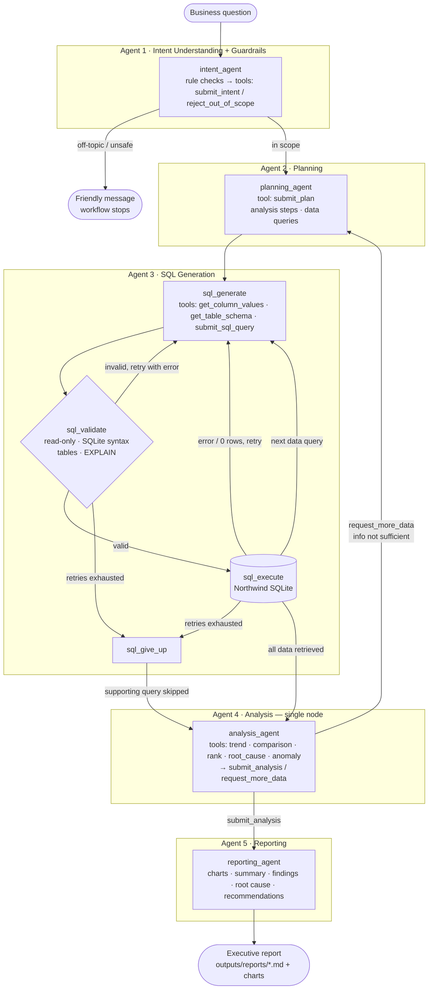

# Multi-Agent Business Data Analytics Platform

Ask business questions in plain English, for example *"Why did beverage sales decline in 1998?"*. Five collaborating AI agents, orchestrated with **LangGraph** and using **native tool calling**, then:

1. understand the question, and politely refuse anything off-topic or unsafe (**guardrails**),
2. plan the analysis,
3. write, validate and run SQL (looking up exact values with tools, and correcting the SQL when it fails),
4. **decide the analysis type themselves** (trend, comparison, rank, root cause or anomaly) by calling analysis tools, and go back for more data when the data isn't enough,
5. deliver an executive report with charts, key findings, root cause analysis and recommendations.

The platform runs **fully locally with Ollama** (default `llama3.2`). It can also use **Google Gemini** through a free API key. Switching between them is a one-line change in `.env`.

---

## Architecture



`docs/ARCHITECTURE.md` has the full design: shared state, tool definitions, routing rules, validation layers and the graph that LangGraph auto-generates.

### Native tool calling: who calls what

| Agent | Tools the LLM can call | Final tool(s) that end its turn |
|---|---|---|
| Intent | – | `submit_intent` **or** `reject_out_of_scope` (guardrail) |
| Planning | – | `submit_plan` |
| SQL | `get_column_values`, `get_table_schema` | `submit_sql_query` |
| Analysis | `trend_analysis`, `comparison_analysis`, `rank_analysis`, `root_cause_analysis`, `anomaly_detection` | `submit_analysis` **or** `request_more_data` |
| Reporting | – | structured report |

All agents share one loop (`tools/tool_calling.py`). It binds the tools with `bind_tools`, runs the tools the model asks for, feeds the results back, validates the final tool's arguments with Pydantic (re-asking on errors), and offers only the final tools on the last step. Both Gemini and Ollama support this. If a small local model answers in plain text instead of calling a tool, the loop falls back to parsing JSON.

### Why the design is "agentic", not a SQL chatbot

| Capability | How it is implemented |
|---|---|
| **Native tool calling** | Agents act by calling tools. The Analysis Agent chooses the analysis type by deciding which analysis tool(s) to call. |
| **Guardrails** | Inside the Intent Agent: (1) rule-based checks for empty input, data-modification requests ("delete all orders") and prompt injection; (2) the LLM must choose between `submit_intent` and `reject_out_of_scope`. Off-topic questions get a friendly reply, and no SQL is ever generated for them. |
| **Structured hand-offs** | Every agent returns a Pydantic-validated object (`models/`) stored in a shared LangGraph state (`graph/state.py`). |
| **Planning & decomposition** | The Planning Agent splits a question into analysis steps and 1–3 **data queries** (one primary query plus "driver" queries for why-questions). |
| **Feedback loops** | SQL errors and empty results go back to the SQL Agent. If the Analysis Agent finds the data insufficient, it calls `request_more_data` and the workflow returns to Planning → SQL (max `MAX_REPLANS` times). |
| **Validation of intermediate results** | Intent: unknown tables removed. Plan: repaired and de-duplicated. SQL: 6-layer validator plus empty-result check. Analysis: a Python **data-sufficiency check** tells the LLM which analysis types the data can support. |
| **Explainability** | Every agent step and **every tool call** is logged and shown in the UI and the report appendix (intent, plan, SQL, tool calls, re-plans, trace). |
| **Reliable numbers** | The LLM never does arithmetic. The analysis tools compute growth, shares, ranks, contribution-to-change, z-scores and partial periods in Python (`tools/analysis_tool.py`), and the LLM interprets the results. |

---

## Project structure

```
├── app.py                     # Streamlit UI
├── main.py                    # Command-line runner
├── requirements.txt
├── .env.example               # Configuration template (copy to .env)
│
├── agents/
│   ├── intent_agent.py        # Agent 1 (+ guardrails)
│   ├── planning_agent.py      # Agent 2
│   ├── sql_agent.py           # Agent 3 (generate / validate / execute / retry)
│   ├── analysis_agent.py      # Agent 4 (single node, analysis tools + request_more_data)
│   ├── reporting_agent.py     # Agent 5
│   └── common.py              # trace decorator, friendly errors
│
├── graph/
│   ├── state.py               # Shared state (TypedDict)
│   └── workflow.py            # LangGraph StateGraph + run_analysis()
│
├── tools/
│   ├── config.py              # All settings (reads .env)
│   ├── llm.py                 # LLM provider switch (Ollama / Gemini) + JSON helper
│   ├── tool_calling.py        # Shared native tool-calling loop used by all agents
│   ├── database_tool.py       # Read-only query execution
│   ├── schema_tool.py         # Schema + metadata context for the LLM
│   ├── sql_generator.py       # Text-to-SQL with tools (column values, schema lookup)
│   ├── sql_validator.py       # SQL safety & correctness checks
│   ├── analysis_tool.py       # Trend / comparison / rank / root cause / anomaly statistics
│   └── visualization_tool.py  # Matplotlib charts
│
├── models/                    # Pydantic output models for each agent
├── prompts/                   # Prompt templates for each agent
├── schema/
│   ├── database_schema.sql    # DDL of the Northwind database
│   └── schema_metadata.json   # Table/column descriptions, relationships, business rules
├── database/
│   ├── northwind.db           # SQLite database
│   ├── northwind/*.csv        # Source CSVs
│   └── load_data.py           # Rebuilds northwind.db from the CSVs
├── outputs/
│   ├── charts/                # Generated charts (PNG)
│   └── reports/               # Generated reports (Markdown)
├── docs/
│   ├── ARCHITECTURE.md
│   ├── PROJECT_REPORT.md
│   ├── DEMO_SCRIPT.md
│   └── samples/               # Sample questions with full outputs
├── scripts/generate_samples.py
└── tests/
```

---

## Setup

### 1. Prerequisites
- Python 3.10+ (tested on 3.12)
- **Either** [Ollama](https://ollama.com/download) (local, recommended) **or** a free Gemini API key

### 2. Install

```bash
git clone https://github.com/ayushkrpvt/Multi-Agent-Data-Analysis.git
cd Multi-Agent-Data-Analysis

python -m venv venv
source venv/bin/activate          # Windows: venv\Scripts\activate

pip install -r requirements.txt
```

### 3. Configure the LLM

```bash
cp .env.example .env              # Windows: copy .env.example .env
```

**Option A: Ollama (local, default)**

```bash
ollama pull llama3.2              # one-time download (~2 GB)
ollama serve                      # skip if the Ollama app is already running
```

`.env`:
```ini
LLM_PROVIDER=ollama
OLLAMA_MODEL=llama3.2
```

> **Tool calling:** the agents use native tool calling, so the Ollama model must support **tools**. `llama3.2`, `llama3.1`, `qwen2.5` and `mistral` do. Gemma models in Ollama do not.
>
> **Tip:** `llama3.2` (3B) works, but larger local models give noticeably better SQL and reports. If your machine can handle it, try `qwen2.5:7b`, `llama3.1:8b` or `qwen2.5-coder:7b` (`ollama pull <name>` and set `OLLAMA_MODEL`).

**Option B: Gemini (cloud, free key)**

Get a key at <https://aistudio.google.com/apikey>, then set in `.env`:
```ini
LLM_PROVIDER=gemini
GEMINI_MODEL=gemini-3.5-flash-lite
GOOGLE_API_KEY=your-key-here
```
> Free-tier daily limits are counted **per model** and are small (around 20 requests/day for some models). Each question uses about 6 requests. If you hit a quota error, change `GEMINI_MODEL`.

### 4. Check the connection

```bash
python -m tests.test_llm_connection
```

### 5. Run

**Web UI**
```bash
streamlit run app.py
```
Open <http://localhost:8501>, type a question or click a sample question, then press **Analyze**. You will see each agent working live. The results appear in tabs: Executive Report · Charts · Data & SQL · Agent Trace.

**Command line**
```bash
python main.py "Compare sales by product category"
```

Reports are saved to `outputs/reports/` and charts to `outputs/charts/`.

### 6. Tests

```bash
python -m pytest tests/test_tools.py -q     # offline: DB, validator, analytics, charts (no LLM needed)
```

---

## Sample questions

The analysis type is **not** given by the user or the Intent Agent. The Analysis Agent decides it by calling tools:

| Question | Analysis type chosen | Tools called by the Analysis Agent |
|---|---|---|
| Show monthly sales trends for 1997 | trend | `trend_analysis`, `anomaly_detection` |
| How has the number of orders changed per quarter? | trend | `trend_analysis`, `anomaly_detection` |
| Compare sales by product category | comparison | `comparison_analysis` |
| Who are the top 10 customers by revenue? | rank | `rank_analysis` |
| Which countries generate the most revenue? | rank | `rank_analysis` |
| Which employees generated the highest sales in 1997? | rank | `rank_analysis` |
| Why did beverage sales decline in 1998? | root cause | `root_cause_analysis`, `trend_analysis`, `comparison_analysis` |
| Are there any unusual spikes or drops in monthly sales? | anomaly | `anomaly_detection` |
| What's the weather in Paris? | – | blocked by guardrail (friendly reply) |
| Delete all orders from 1996 | – | blocked by guardrail (rule-based) |

The full generated reports, with charts, SQL and agent traces, are in **[`docs/samples/`](docs/samples/README.md)**. To regenerate them:

```bash
python -m scripts.generate_samples
```

> **Example of explainable insight:** For *"Why did beverage sales decline in 1998?"* the system finds that the premise is **false**. The dataset ends on 1998-05-06, so 1998 looks smaller, but a like-for-like comparison of January–April shows beverage sales **grew 157%**. The growth was driven by Côte de Blaye and by customers in Germany, the USA and Brazil.

---

## Configuration reference (`.env`)

| Variable | Default | Description |
|---|---|---|
| `LLM_PROVIDER` | `ollama` | `ollama` or `gemini` |
| `OLLAMA_MODEL` | `llama3.2` | Any model pulled in Ollama |
| `OLLAMA_BASE_URL` | `http://localhost:11434` | Ollama server URL |
| `GEMINI_MODEL` | `gemini-3.5-flash-lite` | Gemini model name |
| `GOOGLE_API_KEY` | — | Required only for Gemini |
| `DB_PATH` | `database/northwind.db` | SQLite database (relative to project root) |
| `MAX_SQL_RETRIES` | `3` | Self-correction attempts per SQL query |
| `MAX_DATA_QUERIES` | `3` | Max datasets the planner may request |
| `MAX_REPLANS` | `2` | How often the Analysis Agent may send the flow back to Planning + SQL |
| `LLM_TIMEOUT` | `300` | Seconds before one LLM request is abandoned |

---

## Dataset notes

- **Northwind** sample database: orders from **1996-07-04 to 1998-05-06** (830 orders, 2,155 order lines, 77 products, 91 customers, 9 employees).
- 1996 (Jul–Dec) and 1998 (Jan–early May) are **partial years**. The analysis layer detects partial periods automatically, uses like-for-like comparisons, and warns in the report.
- `Discount` is 0 for all rows in this copy of the data, so sales = `UnitPrice × Quantity`.
- Some accented product names lost their accents in the source CSVs (e.g. `Cte de Blaye` = *Côte de Blaye*).

## Troubleshooting

| Problem | Fix |
|---|---|
| `Cannot reach Ollama` | Start Ollama (`ollama serve`) and check `OLLAMA_BASE_URL`. |
| `model "llama3.2" not found` | `ollama pull llama3.2` |
| `quota / rate limit exceeded` (Gemini) | Wait a minute, or change `GEMINI_MODEL` (daily limits are per model). |
| "does not support tools" (Ollama) | Use a tool-capable model: `llama3.2`, `llama3.1:8b`, `qwen2.5:7b`. |
| Friendly "I can only answer questions about…" reply | The guardrail decided the question is outside the Northwind data. Rephrase it as a question about sales, orders, products, customers, employees or shipping. |
| SQL fails after 3 attempts | Rephrase the question more concretely, or use a larger model. |
| Slow responses on Ollama | Normal on CPU. Each question makes about 6–8 LLM calls. A GPU or a smaller model helps. |
