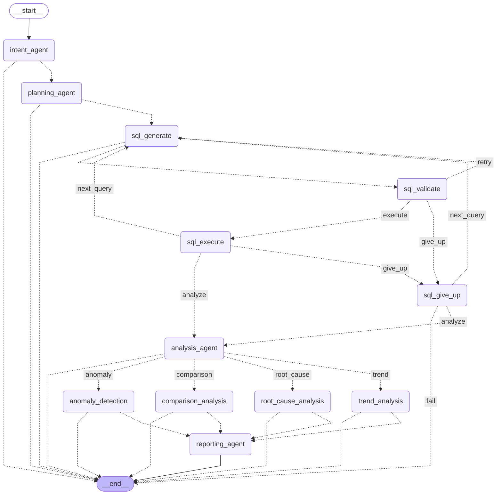

# Architecture

## 1. Overview

The platform is a **LangGraph state machine** with five specialised agents. The agents never call each other directly. Each one reads from a shared, typed **state**, does one job, and writes back a **validated structured output**. LangGraph decides which agent runs next, using **conditional edges**. These implement the SQL retry loop and the choice of analysis branch.

```
Business question
      │
      ▼
┌──────────────────┐   IntentOutput (metric, kpis, dimensions, filters,
│ 1 Intent Agent   │   time_period, analysis_type, required_tables)
└────────┬─────────┘
         ▼
┌──────────────────┐   PlanOutput (objective, analysis_steps, data_queries[1..3],
│ 2 Planning Agent │   required_tables, group_by, kpis, chart_suggestion)
└────────┬─────────┘
         ▼
┌──────────────────┐   for each data query:
│ 3 SQL Agent      │     generate ─► validate ─► execute
│  - schema check  │        ▲   invalid │  error/0 rows │
│  - generation    │        └───────────┴───────────────┘ (max 3 attempts)
│  - validation    │   QueryResult per data query (+ every attempt logged)
│  - execution     │
└────────┬─────────┘
         ▼
┌──────────────────┐   profile datasets (time column, metric, dimensions)
│ 4 Analysis Agent │   route ─► trend | comparison | root_cause | anomaly
│  Python stats    │   facts computed in pandas  ─► LLM interpretation
│  + LLM insight   │   AnalysisOutput (summary, findings, drivers, anomalies, caveats)
└────────┬─────────┘
         ▼
┌──────────────────┐   charts (matplotlib) + ReportOutput (summary, key findings,
│ 5 Reporting Agent│   root cause analysis, recommendations, next questions)
└────────┬─────────┘   ─► outputs/reports/<run_id>.md
         ▼
  Final Executive Report
```

## 2. LangGraph graph (auto-generated)

This diagram is produced by `graph.workflow.mermaid_diagram()` from the compiled graph, so it always matches the code. Dotted arrows are conditional edges. Every agent can also route to `__end__` when it sets `state["error"]`.



Note: `sql_execute` reaches `sql_generate` through two labels, `retry` (fix the same query) and `next_query` (start the next data query). Mermaid draws only one of them.

## 3. Shared state (`graph/state.py`)

| Key | Written by | Purpose |
|---|---|---|
| `user_query`, `run_id` | runner | input |
| `intent` | Intent Agent | structured requirements |
| `plan`, `data_queries` | Planning Agent | analysis steps and datasets to fetch |
| `query_index`, `sql_attempt`, `current_sql`, `sql_error` | SQL Agent | retry-loop state |
| `query_results` | SQL Agent | `query_id -> {sql, columns, records, row_count}` |
| `sql_attempts` *(append)* | SQL Agent | audit log of every attempt and its outcome |
| `profiles`, `analysis_route` | Analysis Agent | data profile and chosen branch |
| `analysis_facts` | Analysis Agent | numbers computed in Python |
| `analysis` | Analysis Agent | LLM interpretation |
| `charts`, `report`, `report_markdown`, `report_path` | Reporting Agent | final deliverables |
| `trace` *(append)* | every node (`@traced`) | agent, step, status, detail, seconds |
| `error` | any node | stops the graph cleanly |

## 4. Agents in detail

### Agent 1: Intent Understanding (`agents/intent_agent.py`)
- The prompt contains the table catalogue (from `schema/schema_metadata.json`) and four few-shot examples, one per analysis type.
- The output is validated by `IntentOutput`. Lenient validators fix common LLM slips: a single string becomes a list, and `"Root Cause"` becomes `root_cause`.
- Post-validation drops any table name that doesn't exist in the database.

### Agent 2: Planning (`agents/planning_agent.py`)
- Turns the intent into ordered `analysis_steps` and 1–`MAX_DATA_QUERIES` **data queries**. Each query has an `id`, a `purpose` and an exact column description.
- Root-cause plans add supporting "driver" queries, e.g. by product and by customer country.
- The planner is told that 1996 and 1998 are partial years, so it requests monthly data for year comparisons.
- Post-validation forces the first query to be `primary`, de-duplicates ids, caps the number of queries, and builds a fallback query if the LLM produced none.

### Agent 3: SQL Generation (`agents/sql_agent.py`, `tools/sql_generator.py`, `tools/sql_validator.py`)
- **Schema check:** the prompt includes only the relevant tables, with column types, descriptions, join keys and business rules (revenue formula, date handling).
- **Generation:** a schema-aware prompt per data query. On retry, the previous SQL and the exact error are included.
- **Validation (6 layers):** non-empty and single statement → forbidden write keywords (whole-word, literals ignored) → non-SQLite functions, with hints (e.g. `YEAR()` → `strftime`) → SQLGlot parse must be a `SELECT`/`WITH` → every table must exist → SQLite `EXPLAIN QUERY PLAN`, which catches unknown columns.
- **Execution:** read-only SQLite connection (`mode=ro`), row cap. A query that returns **0 rows** is treated as a failure and retried with guidance about filter values and date formats.
- **Give-up policy:** if the primary query fails, the run stops with a clear error. If a supporting query fails, it is skipped and the analysis continues.

### Agent 4: Analysis (`agents/analysis_agent.py`, `tools/analysis_tool.py`)
- `analysis_agent` profiles each dataset (time column, metric, dimensions). It checks the requested analysis is possible: a trend request with no time column falls back to comparison.
- Branches:
  - **Trend:** period series, overall and full-period change, peak and low, biggest period-over-period moves, linear slope, per-member growth.
  - **Comparison:** ranking, shares, top-vs-bottom ratio, concentration (top 20% share, members needed for 80%), top combinations.
  - **Root cause:** contribution-to-change decomposition per driver dataset. For monthly data it automatically compares the **same months** in the last two years (like-for-like), plus KPI decomposition (e.g. orders vs sales).
  - **Anomaly:** z-score and IQR fences on a baseline that excludes partial periods.
- **Partial-period detection** uses the dataset coverage (1996-07-04 to 1998-05-06), so incomplete months, quarters and years are never reported as real declines.
- The LLM receives the **computed facts** and a data preview, and returns `AnalysisOutput`. It must cite the computed numbers and is told to say so when the data contradicts the question.

### Agent 5: Reporting (`agents/reporting_agent.py`, `tools/visualization_tool.py`)
- Chart choice is deterministic: trend → line chart (max 6 series + "Other", partial periods shaded); comparison → sorted bar with shares; root cause → diverging contribution chart (blue = increase, red = decrease); anomaly → series with flagged points and normal range.
- The LLM writes `ReportOutput`: business summary, key findings, root cause analysis, prioritised recommendations, next questions.
- The report is saved as Markdown with embedded charts and an appendix: intent, plan, every SQL query and data preview, and the agent trace.

## 5. LLM abstraction (`tools/llm.py`)

| Function | Use |
|---|---|
| `get_llm()` | free-text model (SQL generation) |
| `get_json_llm()` | JSON-mode model (Ollama `format="json"`, Gemini `response_mime_type`) |
| `invoke_json(prompt, Model)` | parse, validate with Pydantic, and **re-ask with the error** on failure |
| `_invoke()` | retries with backoff on temporary errors (503, timeouts) |

The provider is chosen by `LLM_PROVIDER` in `.env`. No other file imports a provider SDK.

## 6. Safety

- Read-only DB connection, and writes/DDL blocked by the validator.
- Single statement only. Row cap on results.
- No LLM-generated code is executed, only validated `SELECT` statements.
