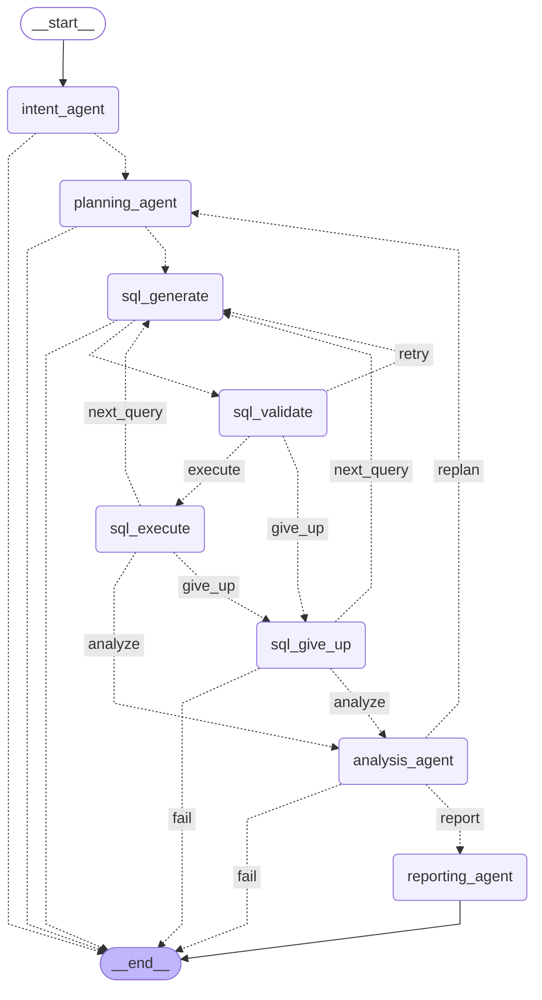

# Architecture

## 1. Overview

The platform is a **LangGraph state machine** with five specialised agents. Agents never call each other directly. Each one reads from a shared, typed **state**, does one job, and writes back a **validated structured output**.

Every agent works through **native tool calling**: the LLM is bound to a set of tools (`bind_tools`), decides which ones to call, receives their results, and ends its turn by calling a *final* tool. LangGraph routes between agents with **conditional edges**, which implement:
- the guardrail exit,
- the SQL self-correction loop,
- the Analysis → Planning re-plan loop.

```
Business question
      │
      ▼
┌────────────────────┐  rule checks ─► blocked? ─► friendly message, END
│ 1 Intent Agent     │  tools: submit_intent | reject_out_of_scope
│   + guardrails     │  IntentOutput (metric, kpis, dimensions, filters, time_period, tables)
└─────────┬──────────┘
          ▼
┌────────────────────┐  tool: submit_plan
│ 2 Planning Agent   │◄────────────────────────────────────────┐
└─────────┬──────────┘  PlanOutput (steps, data_queries[1..3]) │
          ▼                                                     │
┌────────────────────┐  tools: get_column_values,               │
│ 3 SQL Agent        │         get_table_schema,                │
│  generate ⇄ validate ⇄ execute   submit_sql_query            │
└─────────┬──────────┘  QueryResult per data query              │
          ▼                                                     │
┌────────────────────┐  tools: trend_analysis, comparison_analysis,
│ 4 Analysis Agent   │         rank_analysis, root_cause_analysis,
│   (single node)    │         anomaly_detection                │
│                    │  final: submit_analysis ─► Reporting     │
│                    │         request_more_data ───────────────┘ (max MAX_REPLANS)
└─────────┬──────────┘
          ▼
┌────────────────────┐  charts (matplotlib) + ReportOutput
│ 5 Reporting Agent  │  ─► outputs/reports/<run_id>.md
└─────────┬──────────┘
          ▼
  Final Executive Report
```

## 2. LangGraph graph (auto-generated)

This diagram is produced by `graph.workflow.mermaid_diagram()` from the compiled graph, so it always matches the code. Dotted arrows are conditional edges.



Notes:
- `intent_agent → __end__` is the **guardrail exit** (and error exit).
- `analysis_agent → planning_agent` (`replan`) is the **"information not sufficient"** loop.
- `sql_execute → sql_generate` covers two labels, `retry` (fix the same query) and `next_query`. Mermaid draws only one of them.

## 3. Native tool-calling loop (`tools/tool_calling.py`)

```
messages = [system prompt, user prompt]
repeat (max N steps):
    response = LLM.bind_tools(work_tools + final_tools).invoke(messages)
    for each tool call:
        work tool   → run the Python function, append ToolMessage(result)
        final tool  → validate args with Pydantic
                      valid   → return (agent's answer)
                      invalid → append ToolMessage(error) so the LLM corrects itself
    no tool call → remind the LLM to call a tool (or parse JSON from text as fallback)
last step: only final tools are offered, forcing an answer
```

The loop is provider-agnostic (Gemini and Ollama both implement `bind_tools`). Every call is logged into `state["tool_calls"]`.

## 4. Shared state (`graph/state.py`)

| Key | Written by | Purpose |
|---|---|---|
| `user_query`, `run_id` | runner | input |
| `intent`, `guardrail` | Intent Agent | structured requirements / guardrail decision |
| `plan`, `data_queries` | Planning Agent | analysis steps and datasets to fetch (`plan.replans` logs re-plans) |
| `query_index`, `sql_attempt`, `current_sql`, `sql_error` | SQL Agent | retry-loop state |
| `query_results` | SQL Agent | `query_id -> {sql, columns, records, row_count}` |
| `sql_attempts` *(append)* | SQL Agent | every attempt and its outcome |
| `profiles` | Analysis Agent | detected time column / metric / dimensions per dataset |
| `analysis_route` | Analysis Agent | **analysis type chosen by the LLM** |
| `analysis_facts` | Analysis Agent | numbers computed by the analysis tools |
| `analysis` | Analysis Agent | LLM interpretation (`submit_analysis`) |
| `analysis_request`, `replan_count` | Analysis Agent | `request_more_data` → re-planning |
| `charts`, `report`, `report_markdown`, `report_path` | Reporting Agent | final deliverables |
| `tool_calls` *(append)* | every agent | every native tool call (agent, tool, args, result) |
| `trace` *(append)* | every node (`@traced`) | agent, step, status, detail, seconds |
| `error` | any node | stops the graph cleanly |

## 5. Agents in detail

### Agent 1: Intent Understanding + Guardrails (`agents/intent_agent.py`)
- **Output** (`IntentOutput`): business_question, metric, kpis, dimensions, filters, time_period, time_granularity, required_tables. It does **not** decide the analysis type.
- **Guardrail layer 1 (rules, no LLM call):** empty or overly long input; greetings; requests to modify data (`delete`, `truncate`, `drop table`, `update … set`, "change the price…"); prompt injection or secrets ("ignore previous instructions", "system prompt", "API key").
- **Guardrail layer 2 (LLM via tool choice):** the model must call either `submit_intent` or `reject_out_of_scope(category, reason, message)`. Categories are `off_topic`, `greeting`, `unsafe_request`, `unanswerable` (e.g. marketing spend, which isn't in Northwind) and `unclear`.
- A blocked question ends the workflow with a **friendly message and example questions**. No SQL is generated and no data is accessed. No extra node is used: this logic lives inside the Intent Agent.

### Agent 2: Planning (`agents/planning_agent.py`)
- Calls `submit_plan` with ordered `analysis_steps` and 1–`MAX_DATA_QUERIES` **data queries** (id, purpose, exact columns).
- Infers data needs from the question wording (over time → time series; top/bottom → sorted by dimension; why → monthly KPI by driver dimensions; unusual → monthly series).
- **Re-plan mode:** when the Analysis Agent calls `request_more_data`, it receives the reason and the datasets already retrieved, and plans only the *additional* queries (appended; existing results are kept).

### Agent 3: SQL Generation (`agents/sql_agent.py`, `tools/sql_generator.py`, `tools/sql_validator.py`)
- **Tool calling:** `get_column_values(table, column, search)` finds exact filter values (e.g. 'Beverages'); `get_table_schema(tables)` returns extra schema; the final answer is `submit_sql_query(sql, explanation)`. Table and column names are checked against the real schema before any lookup runs.
- **Validation (6 layers):** single statement → forbidden write keywords → non-SQLite functions, with fix hints → SQLGlot must parse it as a SELECT → tables must exist → SQLite `EXPLAIN QUERY PLAN`.
- **Execution:** read-only connection and a row cap. A **0-row result counts as a failure** and is retried with guidance.
- **Retries:** up to `MAX_SQL_RETRIES` per query. If the primary query fails, the run stops with a clear error. A failed supporting query is skipped.

### Agent 4: Analysis, a single node (`agents/analysis_agent.py`, `tools/analysis_tool.py`)
- Receives the outputs of the three previous agents (intent, plan, datasets) plus:
  - the **data coverage** (partial periods),
  - a **data-sufficiency check** computed in Python (which analysis types the data can support).
- **Decides the analysis type** by calling tools:

| Tool | Computes |
|---|---|
| `trend_analysis` | change % over complete periods, peak/low, biggest moves, slope, per-member growth, partial periods |
| `comparison_analysis` | totals, shares, top/bottom ratio, concentration (top-20% share, members for 80%) |
| `rank_analysis` | leaderboard, gap to next, leader margin, cumulative share, bottom members |
| `root_cause_analysis` | like-for-like period comparison (same months) and the contribution of each driver to the change |
| `anomaly_detection` | z-score and IQR outliers on a baseline that excludes partial periods |

- Ends with one of:
  - `submit_analysis(analysis_type, summary, key_findings, insights, drivers, anomalies, caveats)` → Reporting.
  - `request_more_data(reason, needed_data)` → **back to Planning → SQL → Analysis**. Capped at `MAX_REPLANS`; after that the tool is no longer offered.
- Averages and ratios (e.g. AverageFreight) are recognised and never summed or turned into shares.
- If the LLM picks a type without calling its tool, the tool runs deterministically so the facts always exist. If tool calling fails completely, a keyword heuristic plus JSON mode is used.

### Agent 5: Reporting (`agents/reporting_agent.py`, `tools/visualization_tool.py`)
- Chart choice follows the chosen analysis type:
  - trend → line chart (partial periods shaded)
  - comparison → bar chart with shares
  - rank → leaderboard bar chart with #positions
  - root cause → diverging contribution chart
  - anomaly → series with flagged points
- Writes `ReportOutput`: business summary, key findings, root cause analysis, prioritised recommendations, next questions.
- Saves Markdown with charts and an appendix: intent, plan, SQL and data, re-plans, **native tool calls**, agent trace.

## 6. LLM abstraction (`tools/llm.py`)

| Function | Use |
|---|---|
| `get_llm()` | chat model used with `bind_tools` |
| `get_json_llm()` / `invoke_json()` | JSON-mode fallback when tool calling fails |
| `_invoke()` | retries with backoff on temporary errors (503, timeouts) |

The provider is chosen by `LLM_PROVIDER` in `.env`. No other file imports a provider SDK.

## 7. Safety

- Guardrails stop off-topic, unsafe and injection attempts before any SQL is generated.
- Read-only DB connection, and the validator blocks writes/DDL.
- Tool arguments (table and column names) are checked against the schema.
- No LLM-generated code is executed, only validated `SELECT` statements.
