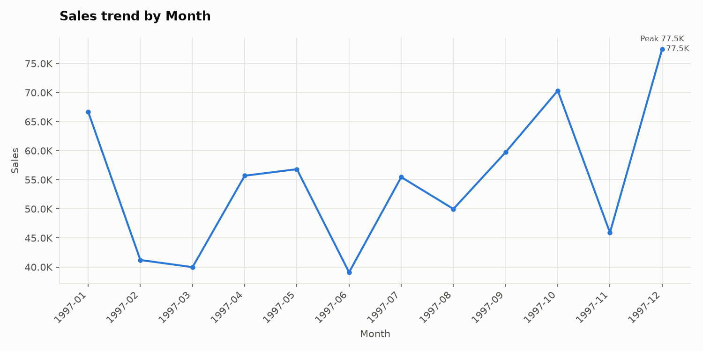

# Monthly Sales Trends for 1997

**Question:** Show monthly sales trends for 1997  
**Analysis type (chosen by Analysis Agent):** trend  
**Generated:** 2026-11-23 00:18 · **LLM:** Gemini (gemini-3.5-flash-lite) · **Dataset:** Northwind

## Business Summary

Monthly sales in 1997 demonstrated an overall upward trend of 16.17% from January ($66,692.80) to December ($77,476.26), with average monthly sales reaching $54,865.73. Throughout the full 12-month period, sales fluctuated significantly, hitting a low point in June at $39,088.00 before recovering strongly to reach a peak in December at $77,476.26.

## Key Findings

- Overall sales increased by 16.17% from January 1997 ($66,692.80) to December 1997 ($77,476.26).
- Average monthly sales across the 12-month period in 1997 were $54,865.73.
- Peak monthly sales occurred in December 1997 at $77,476.26, following a major monthly increase of 68.74%.
- Lowest monthly sales occurred in June 1997 at $39,088.00.
- The largest monthly decrease occurred in February 1997 at -38.21%, dropping sales to $41,207.20.

## Visualizations

### Sales trend by Month



_Metric over time (one line per member when a dimension is present)._

## Root Cause Analysis

- Monthly sales experienced high volatility and seasonal fluctuation across the year, contrasting with the steady linear upward trend of $1,361.65 per period.
- A sharp mid-year dip occurred in June 1997 ($39,088.00) following consecutive softening sales in March and February.
- Strong year-end performance drove a massive 68.74% surge from November ($45,913.36) to December ($77,476.26).
- The dataset represents a complete 12-month period for 1997, ensuring the observed trends are free from partial-period distortion.

## Recommendations

| Priority | Action | Rationale |
|---|---|---|
| High | Investigate the root causes of the mid-year sales slump in June 1997 ($39,088.00) and February 1997 (-38.21% drop) to prevent recurring troughs. | Linked to the finding that monthly sales experience high volatility and sharp drops during certain months despite an overall annual increase. |
| Medium | Analyze the specific product categories and customer segments driving the December peak ($77,476.26) to replicate this success in slower months. | Linked to the finding that December achieved peak sales following a 68.74% surge. |
| Medium | Establish targeted promotional campaigns and marketing pushes ahead of historically softer months like June and November. | Linked to the finding that sales drop significantly during mid-year and late autumn periods. |

## Data Caveats

- Dataset contains orders from 1996-07-04 to 1998-05-06; 1997 is a full 12-month period.

## Suggested Next Questions

- Which specific products or categories drove the December 1997 sales peak?
- What factors contributed to the sharp drop in sales between January and February 1997?
- How do the monthly sales patterns and average of $54,865.73 in 1997 compare to the available periods in 1996 and 1998?

---
## Appendix: How This Answer Was Produced

### 1. Intent (Intent Agent)
```json
{
  "business_question": "Show monthly sales trends for 1997",
  "metric": "Sales",
  "kpis": [
    "Sales"
  ],
  "dimensions": [
    "Month"
  ],
  "filters": [],
  "time_period": "1997",
  "time_granularity": "month",
  "required_tables": [
    "orders",
    "order_details"
  ]
}
```

### 2. Execution Plan (Planning Agent)
**Objective:** Show monthly sales trends for 1997

1. Extract monthly sales for the year 1997
2. Analyze trends across months

### 3. Data Retrieval (SQL Agent)

**primary** - Monthly sales trend for 1997 (12 rows, 1 attempt(s))

```sql
SELECT 
  strftime('%Y-%m', o.OrderDate) AS Month,
  ROUND(SUM(od.UnitPrice * od.Quantity * (1 - od.Discount)), 2) AS Sales,
  SUM(od.Quantity) AS Quantity,
  COUNT(DISTINCT o.OrderID) AS Orders
FROM orders o
JOIN order_details od ON o.OrderID = od.OrderID
WHERE strftime('%Y', o.OrderDate) = '1997'
GROUP BY strftime('%Y-%m', o.OrderDate)
ORDER BY Month
```

| Month   |     Sales |   Quantity |   Orders |
|:--------|----------:|-----------:|---------:|
| 1997-01 | 66,692.80 |       2401 |       33 |
| 1997-02 | 41,207.20 |       2132 |       29 |
| 1997-03 | 39,979.90 |       1770 |       30 |
| 1997-04 | 55,699.39 |       1912 |       31 |
| 1997-05 | 56,823.70 |       2164 |       32 |
| 1997-06 | 39,088.00 |       1635 |       30 |
| 1997-07 | 55,464.93 |       2054 |       33 |
| 1997-08 | 49,981.69 |       1861 |       33 |
| 1997-09 | 59,733.02 |       2343 |       37 |
| 1997-10 | 70,328.50 |       2679 |       38 |

### 5. Native Tool Calls

| # | Agent | Tool | Arguments |
|---|---|---|---|
| 1 | Intent Agent | `submit_intent` | {"time_granularity": "month", "kpis": ["Sales"], "metric": "Sales", "dimensions": ["Month"], "time_period": "1997", "req |
| 2 | Planning Agent | `submit_plan` | {"required_tables": ["orders", "order_details"], "group_by": ["Month"], "data_queries": [{"purpose": "Monthly sales tren |
| 3 | SQL Agent | `submit_sql_query` | {"explanation": "Monthly sales trend (Sales, Quantity, Orders) for the year 1997.", "tables_used": ["orders", "order_det |
| 4 | Analysis Agent | `trend_analysis` | {"dataset_id": "primary"} |
| 5 | Analysis Agent | `anomaly_detection` | {"dataset_id": "primary", "z_threshold": 2} |
| 6 | Analysis Agent | `submit_analysis` | {"analysis_type": "trend", "summary": "Monthly sales in 1997 showed an overall upward trend of 16.17% from January ($66, |

### 6. Agent Trace

| # | Agent | Step | Status | Time (s) |
|---|---|---|---|---|
| 1 | Intent Agent | understand question + guardrails | ok | 5.28 |
| 2 | Planning Agent | create execution plan | ok | 4.57 |
| 3 | SQL Agent | generate SQL | ok | 5.13 |
| 4 | SQL Agent | validate SQL | ok | 0.02 |
| 5 | SQL Agent | execute SQL | ok | 0.03 |
| 6 | Analysis Agent | choose analysis via tool calling | ok | 13.79 |
