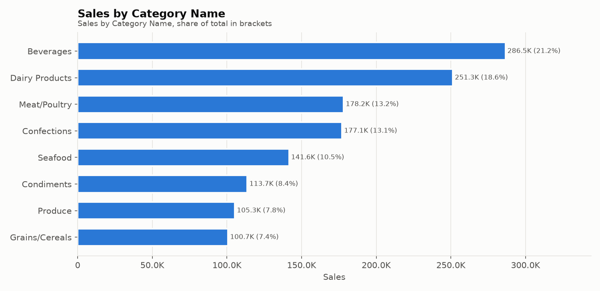

# Executive Report: Sales Comparison by Product Category

**Question:** Compare sales by product category  
**Analysis type (chosen by Analysis Agent):** comparison  
**Generated:** 2026-11-23 00:18 · **LLM:** Gemini (gemini-3.5-flash-lite) · **Dataset:** Northwind

## Business Summary

Total sales across all 8 product categories reached $1,354,458.59 for the period spanning 1996-07-04 to 1998-05-06. Beverages leads all categories as the top-performing segment with $286,526.95 in sales, capturing a 21.15% share. Conversely, Grains/Cereals registered the lowest sales at $100,726.80, representing a 7.44% share of total revenue.

## Key Findings

- Total sales across all 8 product categories reached $1,354,458.59.
- Beverages is the top-performing category with $286,526.95 in sales (21.15% share).
- Dairy Products follows closely in second place with $251,330.50 in sales (18.56% share).
- Grains/Cereals is the lowest-performing category with $100,726.80 in sales (7.44% share).
- Top vs bottom category sales ratio stands at 2.84.
- Beverages and Dairy Products together account for nearly 40% (39.71%) of total revenue.

## Visualizations

### Sales by Category Name



_Ranking of members by the metric._

## Root Cause Analysis

- Beverages and Dairy Products dominate total revenue, together generating nearly 40% of all sales due to high customer demand and broad product variety.
- Grains/Cereals, Produce, and Condiments generate the lowest sales, each holding under 8.5% share of total revenue.
- Data covers the full period from 1996-07-04 to 1998-05-06 without time granularity in this dataset, indicating that totals reflect cumulative historical performance.

## Recommendations

| Priority | Action | Rationale |
|---|---|---|
| High | Increase marketing and inventory allocation for Beverages and Dairy Products. | These two categories drive nearly 40% (39.71%) of total sales, making them critical revenue pillars. |
| Medium | Review pricing and promotional strategies for Grains/Cereals, Produce, and Condiments. | These categories currently underperform, generating the lowest sales with shares under 8.5%. |
| Low | Investigate cross-selling opportunities between top categories like Beverages and lower-performing segments like Grains/Cereals. | Leveraging the high volume of Beverages ($286,526.95) can help lift lagging product lines. |

## Data Caveats

- Data covers the full period from 1996-07-04 to 1998-05-06 without time granularity in this dataset.

## Suggested Next Questions

- What specific products within Beverages and Dairy Products are driving the highest sales volumes?
- How do category sales break down on a monthly or yearly basis within the 1996-07-04 to 1998-05-06 period?
- Which customer segments or geographic regions purchase the most Grains/Cereals and Produce?

---
## Appendix: How This Answer Was Produced

### 1. Intent (Intent Agent)
```json
{
  "business_question": "Compare sales by product category",
  "metric": "Sales",
  "kpis": [
    "Sales",
    "Quantity",
    "Orders"
  ],
  "dimensions": [
    "Category"
  ],
  "filters": [],
  "time_period": "All",
  "time_granularity": "none",
  "required_tables": [
    "categories",
    "products",
    "order_details"
  ]
}
```

### 2. Execution Plan (Planning Agent)
**Objective:** Compare sales, quantity, and order count across all product categories

1. Query total sales, quantity, and orders per product category across all time
2. Sort categories by sales descending to show the top categories
3. Format as a bar chart for comparison

### 3. Data Retrieval (SQL Agent)

**primary** - Get total sales, quantity, and orders for each product category across all time (8 rows, 1 attempt(s))

```sql
SELECT 
    c.CategoryName,
    ROUND(SUM(od.UnitPrice * od.Quantity * (1 - od.Discount)), 2) AS Sales,
    SUM(od.Quantity) AS Quantity,
    COUNT(DISTINCT o.OrderID) AS Orders
FROM categories c
JOIN products p ON c.CategoryID = p.CategoryID
JOIN order_details od ON p.ProductID = od.ProductID
JOIN orders o ON od.OrderID = o.OrderID
GROUP BY c.CategoryName
ORDER BY Sales DESC
```

| CategoryName   |      Sales |   Quantity |   Orders |
|:---------------|-----------:|-----------:|---------:|
| Beverages      | 286,526.95 |       9532 |      354 |
| Dairy Products | 251,330.50 |       9149 |      303 |
| Meat/Poultry   | 178,188.80 |       4199 |      161 |
| Confections    | 177,099.10 |       7906 |      295 |
| Seafood        | 141,623.09 |       7681 |      291 |
| Condiments     | 113,694.75 |       5298 |      193 |
| Produce        | 105,268.60 |       2990 |      129 |
| Grains/Cereals | 100,726.80 |       4562 |      182 |

### 5. Native Tool Calls

| # | Agent | Tool | Arguments |
|---|---|---|---|
| 1 | Intent Agent | `submit_intent` | {"time_period": "All", "metric": "Sales", "dimensions": ["Category"], "time_granularity": "none", "required_tables": ["c |
| 2 | Planning Agent | `submit_plan` | {"required_tables": ["categories", "products", "order_details", "orders"], "objective": "Compare sales, quantity, and or |
| 3 | SQL Agent | `submit_sql_query` | {"tables_used": ["categories", "products", "order_details", "orders"], "sql": "SELECT \n    c.CategoryName,\n    ROUND(S |
| 4 | Analysis Agent | `comparison_analysis` | {"dataset_id": "primary"} |
| 5 | Analysis Agent | `submit_analysis` | {"drivers": [], "summary": "Total sales across all 8 product categories reached $1,354,458.59. Beverages leads all categ |

### 6. Agent Trace

| # | Agent | Step | Status | Time (s) |
|---|---|---|---|---|
| 1 | Intent Agent | understand question + guardrails | ok | 7.03 |
| 2 | Planning Agent | create execution plan | ok | 6.46 |
| 3 | SQL Agent | generate SQL | ok | 2.12 |
| 4 | SQL Agent | validate SQL | ok | 0.01 |
| 5 | SQL Agent | execute SQL | ok | 0.01 |
| 6 | Analysis Agent | choose analysis via tool calling | ok | 8.25 |
