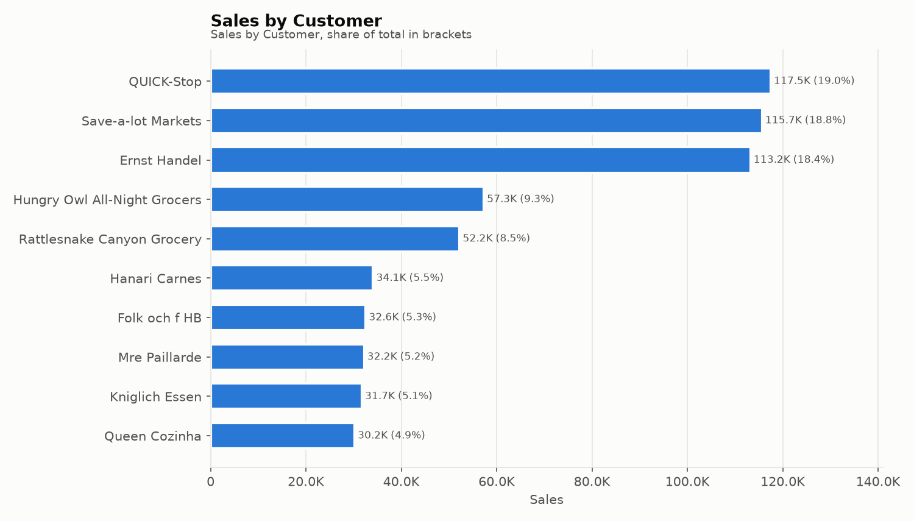

# Top 10 Customers by Revenue Analysis

**Question:** Who are the top 10 customers by revenue?  
**Analysis type:** comparison  
**Generated:** 2026-11-18 23:44 · **LLM:** Gemini (gemini-3.5-flash-lite) · **Dataset:** Northwind

## Business Summary

QUICK-Stop leads the top 10 customers with $117,483.39 in sales, closely followed by Save-a-lot Markets and Ernst Handel. Together, the top 3 customers account for over 56% of the total top 10 revenue of $616,789.20. Note that the dataset contains orders from 1996-07-04 to 1998-05-06 only, meaning year-over-year totals for 1996 and 1998 represent partial years.

## Key Findings

- Top customer by revenue is QUICK-Stop with $117,483.39 in sales (19.05% share).
- Save-a-lot Markets is the second top customer with $115,673.39 in sales (18.75% share).
- Ernst Handel is the third top customer with $113,236.68 in sales (18.36% share).
- Queen Cozinha is the 10th customer with the lowest sales in the top group at $30,226.10 (4.90% share).
- Total revenue for the top 10 customers combined is $616,789.20.

## Visualizations

### Sales by Customer



_Ranking of members by the metric._

## Root Cause Analysis

- High revenue concentration exists among the top 3 customers (QUICK-Stop, Save-a-lot Markets, and Ernst Handel), who each hold roughly 18% to 19% share of the top 10 total.
- Dataset contains orders from 1996-07-04 to 1998-05-06 only, meaning 1996 contains only Jul-Dec and 1998 only Jan-early May, making year-over-year totals partial periods.

## Recommendations

| Priority | Action | Rationale |
|---|---|---|
| High | Assign dedicated account managers to QUICK-Stop, Save-a-lot Markets, and Ernst Handel. | They contribute over 56% of the top 10 total revenue, so losing any of these top 3 clients would severely impact overall revenue. |
| Medium | Implement loyalty programs or volume incentives for Queen Cozinha and other lower-ranking members in the top 10. | Queen Cozinha represents the lowest sales in the top group at $30,226.10 and can be nurtured to increase order frequency. |
| Low | Analyze purchasing patterns across customers using normalized equal periods rather than partial calendar years. | The dataset spans partial periods from 1996-07-04 to 1998-05-06, requiring careful comparison using monthly averages or equal timeframes. |

## Data Caveats

- Dataset contains orders from 1996-07-04 to 1998-05-06 only. 1996 contains only Jul-Dec and 1998 only Jan-early May. Year-over-year totals for 1996 and 1998 are PARTIAL years; compare equal periods (e.g. Jan-Apr) or monthly averages.

## Suggested Next Questions

- What specific product categories do QUICK-Stop, Save-a-lot Markets, and Ernst Handel purchase most frequently?
- What is the order frequency and average order value for Queen Cozinha compared to QUICK-Stop?

---
## Appendix: How This Answer Was Produced

### 1. Intent (Intent Agent)
```json
{
  "business_question": "Who are the top 10 customers by revenue?",
  "metric": "Sales",
  "kpis": [
    "Sales"
  ],
  "dimensions": [
    "Customer"
  ],
  "filters": [],
  "time_period": "All",
  "time_granularity": "none",
  "analysis_type": "comparison",
  "required_tables": [
    "customers",
    "orders",
    "order_details"
  ]
}
```

### 2. Execution Plan (Planning Agent)
**Objective:** Identify the top 10 customers based on total revenue generated.

1. Aggregate total sales by customer across all available time periods
2. Rank customers in descending order of sales
3. Select the top 10 customers and calculate their revenue contribution

### 3. Data Retrieval (SQL Agent)

**primary** - Calculate total sales per customer to identify the top 10 (10 rows, 1 attempt(s))

```sql
SELECT 
    c.CompanyName AS Customer,
    ROUND(SUM(od.UnitPrice * od.Quantity * (1 - od.Discount)), 2) AS Sales
FROM customers c
JOIN orders o ON c.CustomerID = o.CustomerID
JOIN order_details od ON o.OrderID = od.OrderID
GROUP BY c.CustomerID, c.CompanyName
ORDER BY Sales DESC
LIMIT 10
```

| Customer                     |      Sales |
|:-----------------------------|-----------:|
| QUICK-Stop                   | 117,483.39 |
| Save-a-lot Markets           | 115,673.39 |
| Ernst Handel                 | 113,236.68 |
| Hungry Owl All-Night Grocers |  57,317.39 |
| Rattlesnake Canyon Grocery   |  52,245.90 |
| Hanari Carnes                |  34,101.15 |
| Folk och f HB                |  32,555.55 |
| Mre Paillarde                |  32,203.90 |
| Kniglich Essen               |  31,745.75 |
| Queen Cozinha                |  30,226.10 |

### 4. Agent Trace

| # | Agent | Step | Status | Time (s) |
|---|---|---|---|---|
| 1 | Intent Agent | understand question | ok | 17.87 |
| 2 | Planning Agent | create execution plan | ok | 15.64 |
| 3 | SQL Agent | generate SQL | ok | 1.6 |
| 4 | SQL Agent | validate SQL | ok | 0.02 |
| 5 | SQL Agent | execute SQL | ok | 0.05 |
| 6 | Analysis Agent | profile data & choose analysis | ok | 0.02 |
| 7 | Analysis Agent | comparison analysis | ok | 3.07 |
