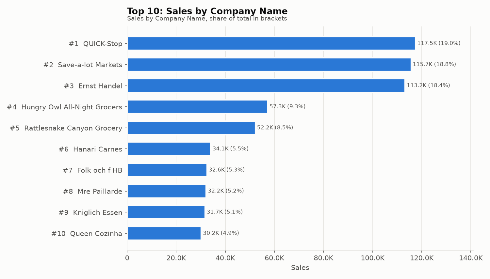

# Top 10 Customers by Revenue Analysis

**Question:** Who are the top 10 customers by revenue?  
**Analysis type (chosen by Analysis Agent):** rank  
**Generated:** 2026-11-23 00:19 · **LLM:** Gemini (gemini-3.5-flash-lite) · **Dataset:** Northwind

## Business Summary

The top customer by revenue is QUICK-Stop with $117,483.39, followed closely by Save-a-lot Markets with $115,673.39 and Ernst Handel with $113,236.68. Together, the top 3 customers represent over 56% of the total revenue among the top 10 customers evaluated from 1996-07-04 to 1998-05-06. The tenth customer, Queen Cozinha, recorded $30,226.10 in sales.

## Key Findings

- Top customer by revenue is QUICK-Stop with $117,483.39.
- Second customer by revenue is Save-a-lot Markets with $115,673.39, trailing by a slim margin of only $1,810.00.
- Third customer by revenue is Ernst Handel with $113,236.68.
- Tenth customer by revenue is Queen Cozinha with $30,226.10.
- The top 3 customers alone account for 56.16% of total revenue among the top 10 customers.

## Visualizations

### Top 10: Sales by Company Name



_Leaderboard with rank positions._

## Root Cause Analysis

- High revenue concentration among the top 3 customers (QUICK-Stop, Save-a-lot Markets, and Ernst Handel), who collectively drive more than half of the top 10 sales.
- A very tight competition at the very top, where QUICK-Stop holds only a 1.56% gap over Save-a-lot Markets.
- Dataset limitations restrict the view to the top 10 ranked members totaling $616,789.20 across the period from 1996-07-04 to 1998-05-06.

## Recommendations

| Priority | Action | Rationale |
|---|---|---|
| High | Establish dedicated account management and loyalty programs for QUICK-Stop and Save-a-lot Markets. | QUICK-Stop and Save-a-lot Markets generate the highest revenues ($117,483.39 and $115,673.39 respectively) with a very narrow gap, making them prime targets for retention efforts. |
| Medium | Implement targeted growth campaigns for mid-tier customers like Queen Cozinha and Königlich Essen. | Queen Cozinha represents the tenth position with $30,226.10, indicating potential to scale lower-ranking accounts and reduce overall revenue concentration risk. |
| High | Monitor order frequency and product preferences for Ernst Handel, the third-largest customer. | Ernst Handel contributes $113,236.68 (18.36% share) and is part of the top 3 core revenue cluster that dictates overall financial performance. |

## Data Caveats

- The dataset provided contains only 8 rows initially, but rank_analysis evaluated the dataset of 10 rows.

## Suggested Next Questions

- What specific product categories are driving the high order volumes for QUICK-Stop and Save-a-lot Markets?
- How frequently do the top 3 customers place orders compared to the lower-ranked customers like Queen Cozinha?
- What is the historical purchase trend for Ernst Handel across the full 1996-1998 period?

---
## Appendix: How This Answer Was Produced

### 1. Intent (Intent Agent)
```json
{
  "business_question": "Who are the top 10 customers by revenue?",
  "metric": "Sales",
  "kpis": [
    "Sales"
  ],
  "dimensions": [
    "Customer"
  ],
  "filters": [],
  "time_period": "All",
  "time_granularity": "none",
  "required_tables": [
    "customers",
    "orders",
    "order_details"
  ]
}
```

### 2. Execution Plan (Planning Agent)
**Objective:** Identify the top 10 customers by total revenue.

1. Aggregate total revenue (Sales) per customer across all orders
2. Rank customers in descending order of revenue
3. Limit the results to the top 10 customers

### 3. Data Retrieval (SQL Agent)

**primary** - Total revenue per customer for top 10 ranking (10 rows, 1 attempt(s))

```sql
SELECT 
    c.CompanyName, 
    ROUND(SUM(od.UnitPrice * od.Quantity * (1 - od.Discount)), 2) AS Sales
FROM customers c
JOIN orders o ON c.CustomerID = o.CustomerID
JOIN order_details od ON o.OrderID = od.OrderID
GROUP BY c.CustomerID, c.CompanyName
ORDER BY Sales DESC
LIMIT 10
```

| CompanyName                  |      Sales |
|:-----------------------------|-----------:|
| QUICK-Stop                   | 117,483.39 |
| Save-a-lot Markets           | 115,673.39 |
| Ernst Handel                 | 113,236.68 |
| Hungry Owl All-Night Grocers |  57,317.39 |
| Rattlesnake Canyon Grocery   |  52,245.90 |
| Hanari Carnes                |  34,101.15 |
| Folk och f HB                |  32,555.55 |
| Mre Paillarde                |  32,203.90 |
| Kniglich Essen               |  31,745.75 |
| Queen Cozinha                |  30,226.10 |

### 5. Native Tool Calls

| # | Agent | Tool | Arguments |
|---|---|---|---|
| 1 | Intent Agent | `submit_intent` | {"dimensions": ["Customer"], "metric": "Sales", "required_tables": ["customers", "orders", "order_details"], "filters":  |
| 2 | Planning Agent | `submit_plan` | {"required_tables": ["customers", "orders", "order_details"], "analysis_steps": ["Aggregate total revenue (Sales) per cu |
| 3 | SQL Agent | `submit_sql_query` | {"sql": "SELECT \n    c.CompanyName, \n    ROUND(SUM(od.UnitPrice * od.Quantity * (1 - od.Discount)), 2) AS Sales\nFROM  |
| 4 | Analysis Agent | `rank_analysis` | {"ascending": false, "top_n": 10, "dataset_id": "primary"} |
| 5 | Analysis Agent | `submit_analysis` | {"summary": "The top customer by revenue is QUICK-Stop with $117,483.39, followed closely by Save-a-lot Markets with $11 |

### 6. Agent Trace

| # | Agent | Step | Status | Time (s) |
|---|---|---|---|---|
| 1 | Intent Agent | understand question + guardrails | ok | 1.42 |
| 2 | Planning Agent | create execution plan | ok | 5.4 |
| 3 | SQL Agent | generate SQL | ok | 4.35 |
| 4 | SQL Agent | validate SQL | ok | 0.01 |
| 5 | SQL Agent | execute SQL | ok | 0.01 |
| 6 | Analysis Agent | choose analysis via tool calling | ok | 8.22 |
