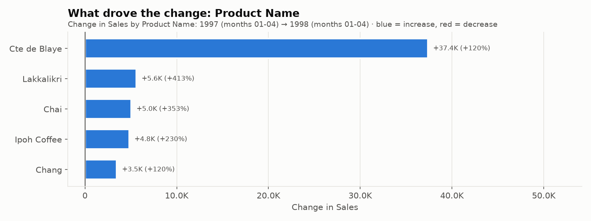
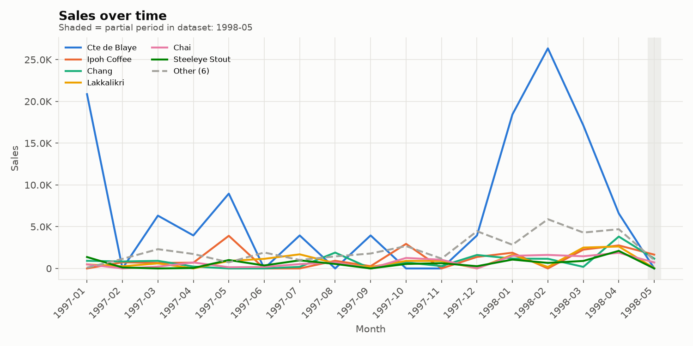

# Beverage Sales Performance Analysis for 1998

**Question:** Why did beverage sales decline in 1998?  
**Analysis type:** root_cause  
**Generated:** 2026-11-18 23:45 · **LLM:** Gemini (gemini-3.5-flash-lite) · **Dataset:** Northwind

## Business Summary

The premise that beverage sales declined in 1998 is contradicted by the data; like-for-like sales for the first four months of 1998 actually grew by 157.28% compared to the same period in 1997. Total sales rose from 45,719.5 in Jan-Apr 1997 to 117,626.75 in Jan-Apr 1998. The apparent annual drop is an artifact of incomplete data collection ending in early May 1998.

## Key Findings

- Like-for-like beverage sales grew by 157.28% for January through April 1998 compared to January through April 1997.
- Total sales for Jan-Apr 1997 were 45,719.5, whereas total sales for Jan-Apr 1998 reached 117,626.75.
- Cté de Blaye was the leading product driver, increasing by 37,364.3 and contributing 51.96% of the total change.
- Germany, USA, and Brazil drove major geographic expansion, with Germany increasing by 28,638.75 and USA increasing by 24,074.0.
- Secondary markets like Denmark and Canada experienced declines, dropping by 97.25% and 84.08% respectively.
- Sales experienced an abrupt month-over-month decline of -81.21% from April to May 1998 due to partial period coverage.

## Visualizations

### What drove the change: Product Name



_Contribution of each member to the total change between the compared periods._

### What drove the change: Country


_Contribution of each member to the total change between the compared periods._

### Sales over time



_Context: metric over time._

## Root Cause Analysis

- The dataset contains orders only from 1996-07-04 to 1998-05-06, making the 1998 annual totals a partial period rather than a real business decline.
- Massive growth in core products like Cté de Blaye (up 119.97%) and Lakkalikööri (up 413.3%) offset regional contractions.
- Strong market expansion in Germany (up 997.87%) and Brazil (up 7,241.23%) propelled overall positive performance.
- Contractions in specific secondary markets, such as Denmark (down 10337.5) and Canada (down 9411.7), served as minor headwinds.

## Recommendations

| Priority | Action | Rationale |
|---|---|---|
| High | Investigate distribution and demand bottlenecks in Denmark and Canada to reverse the 97.25% and 84.08% sales drops in those countries. | Denmark and Canada showed significant negative contributions to overall performance despite strong global growth. |
| High | Scale marketing and supply chain support for top-performing products like Cté de Blaye and Lakkalikööri. | Cté de Blaye alone contributed 51.96% of the total sales change, heavily driving the 157.28% like-for-like growth. |
| Medium | Allocate additional sales resources to high-growth markets including Germany, the USA, and Brazil. | These countries demonstrated massive surges (e.g., Germany up 28,638.75 and USA up 24,074.0), acting as the primary engines of expansion. |
| Medium | Establish data collection audits to ensure complete monthly reporting and prevent artificial anomalies like the May 1998 drop. | The apparent annual drop was entirely an artifact of data ending on 1998-05-06 rather than a true market downturn. |

## Data Caveats

- Dataset contains orders from 1996-07-04 to 1998-05-06 only.
- Periods present in this data that are PARTIAL (incomplete, not a real decline): ['1998-05']

## Suggested Next Questions

- What specific factors caused the sharp sales declines in Denmark and Canada during early 1998?
- Can the exceptionally high growth rates observed in Brazil and Germany be sustained through the rest of the year?
- What is the updated sales trajectory once complete order data beyond May 1998 becomes available?

---
## Appendix: How This Answer Was Produced

### 1. Intent (Intent Agent)
```json
{
  "business_question": "Why did beverage sales decline in 1998?",
  "metric": "Sales",
  "kpis": [
    "Sales",
    "Orders",
    "Quantity"
  ],
  "dimensions": [
    "Month",
    "Product"
  ],
  "filters": [
    "Category = Beverages"
  ],
  "time_period": "1997-1998",
  "time_granularity": "month",
  "analysis_type": "root_cause",
  "required_tables": [
    "products",
    "categories",
    "orders",
    "order_details",
    "customers"
  ]
}
```

### 2. Execution Plan (Planning Agent)
**Objective:** Explain the decline in Beverages sales during 1998 compared to 1997 through product and customer analysis

1. Compare monthly Beverages sales for 1997 and 1998 up to May
2. Decompose the sales decline by individual products within the Beverages category
3. Identify key customer countries contributing to the change in Beverages sales
4. Summarize the primary drivers for the 1998 decline

### 3. Data Retrieval (SQL Agent)

**primary** - Monthly Beverages sales and quantity by product for 1997-1998 (154 rows, 1 attempt(s))

```sql
SELECT 
    strftime('%Y-%m', o.OrderDate) AS Month,
    p.ProductName,
    ROUND(SUM(od.UnitPrice * od.Quantity * (1 - od.Discount)), 2) AS Sales,
    SUM(od.Quantity) AS Quantity,
    COUNT(DISTINCT o.OrderID) AS Orders
FROM orders o
JOIN order_details od ON o.OrderID = od.OrderID
JOIN products p ON od.ProductID = p.ProductID
JOIN categories c ON p.CategoryID = c.CategoryID
WHERE c.CategoryName = 'Beverages'
  AND strftime('%Y', o.OrderDate) IN ('1997', '1998')
GROUP BY strftime('%Y-%m', o.OrderDate), p.ProductName
ORDER BY Month, Sales DESC
```

| Month   | ProductName      |     Sales |   Quantity |   Orders |
|:--------|:-----------------|----------:|-----------:|---------:|
| 1997-01 | Cte de Blaye     | 20,869.20 |         99 |        2 |
| 1997-01 | Steeleye Stout   |  1,368.00 |         95 |        2 |
| 1997-01 | Chang            |    912.00 |         60 |        1 |
| 1997-01 | Lakkalikri       |    489.60 |         34 |        2 |
| 1997-01 | Chai             |    489.60 |         34 |        2 |
| 1997-01 | Outback Lager    |     96.00 |          8 |        1 |
| 1997-02 | Chang            |    836.00 |         55 |        2 |
| 1997-02 | Ipoh Coffee      |    736.00 |         20 |        1 |
| 1997-02 | Chartreuse verte |    374.40 |         26 |        2 |
| 1997-02 | Outback Lager    |    300.00 |         25 |        1 |

**by_country** - Monthly Beverages sales by customer country for 1997-1998 (161 rows, 1 attempt(s))

```sql
SELECT 
  strftime('%Y-%m', o.OrderDate) AS Month,
  c.Country AS Country,
  ROUND(SUM(od.UnitPrice * od.Quantity * (1 - od.Discount)), 2) AS Sales
FROM orders AS o
JOIN order_details AS od ON o.OrderID = od.OrderID
JOIN products AS p ON od.ProductID = p.ProductID
JOIN categories AS cat ON p.CategoryID = cat.CategoryID
JOIN customers AS c ON o.CustomerID = c.CustomerID
WHERE cat.CategoryName = 'Beverages'
  AND strftime('%Y', o.OrderDate) IN ('1997', '1998')
GROUP BY strftime('%Y-%m', o.OrderDate), c.Country
ORDER BY Month, Sales DESC
```

| Month   | Country   |     Sales |
|:--------|:----------|----------:|
| 1997-01 | Canada    | 11,193.20 |
| 1997-01 | Denmark   | 10,540.00 |
| 1997-01 | Germany   |    912.00 |
| 1997-01 | France    |    835.20 |
| 1997-01 | UK        |    504.00 |
| 1997-01 | Brazil    |    240.00 |
| 1997-02 | Belgium   |    736.00 |
| 1997-02 | USA       |    684.00 |
| 1997-02 | Sweden    |    485.60 |
| 1997-02 | UK        |    452.00 |

### 4. Agent Trace

| # | Agent | Step | Status | Time (s) |
|---|---|---|---|---|
| 1 | Intent Agent | understand question | ok | 7.15 |
| 2 | Planning Agent | create execution plan | ok | 7.78 |
| 3 | SQL Agent | generate SQL | ok | 2.01 |
| 4 | SQL Agent | validate SQL | ok | 0.02 |
| 5 | SQL Agent | execute SQL | ok | 0.02 |
| 6 | SQL Agent | generate SQL | ok | 8.35 |
| 7 | SQL Agent | validate SQL | ok | 0.01 |
| 8 | SQL Agent | execute SQL | ok | 0.02 |
| 9 | Analysis Agent | profile data & choose analysis | ok | 0.01 |
| 10 | Analysis Agent | root cause analysis | ok | 9.64 |
