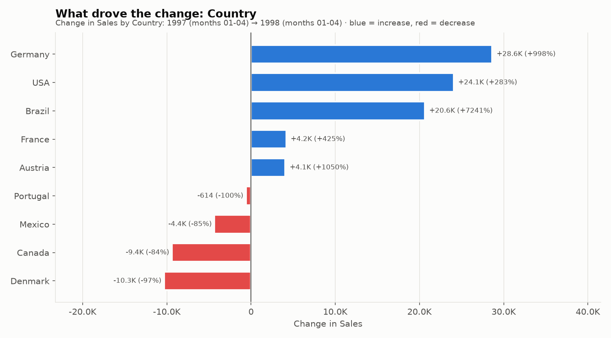

# Beverage Sales Performance Analysis for 1998

**Question:** Why did beverage sales decline in 1998?  
**Analysis type (chosen by Analysis Agent):** root_cause  
**Generated:** 2026-11-23 00:20 · **LLM:** Gemini (gemini-3.5-flash-lite) · **Dataset:** Northwind

## Business Summary

Beverage sales did not decline in 1998; the apparent drop is an artifact of incomplete data for May 1998. On a like-for-like comparison from January to April, beverage sales actually grew by 157.28% from 45,719.50 in 1997 to 117,626.75 in 1998. This strong performance was driven by massive gains in key markets like Germany and the USA, alongside robust product growth in items like Cte de Blaye.

## Key Findings

- Like-for-like beverage sales for January to April grew by +157.28%, increasing from 45,719.50 in 1997 to 117,626.75 in 1998.
- Germany experienced the largest country growth, surging by 28,638.75 (997.87%) between the Jan-Apr periods.
- USA followed closely as a top growth driver, increasing sales by 24,074.00 (282.72%) in early 1998.
- Cte de Blaye was the top positive product contributor, growing by 37,364.30 (119.97%) and accounting for 51.96% of total growth.
- Denmark and Canada saw notable declines during the Jan-Apr comparison, dropping by 10,337.50 and 9,411.70 respectively.

## Visualizations

### What drove the change: Product Name


_Contribution of each member to the total change between the compared periods._

### What drove the change: Country



_Contribution of each member to the total change between the compared periods._

### Sales over time


_Context: metric over time._

## Root Cause Analysis

- Apparent declines in 1998 are strictly due to partial data coverage for May 1998, with orders only running up to 1998-05-06.
- Significant geographical expansion in Germany, USA, and Brazil heavily outweighed contractions in markets like Denmark and Canada.
- Strong product demand for high-value items such as Cte de Blaye, Lakkalikri, and Chai propelled the overall revenue upward on a like-for-like basis.

## Recommendations

| Priority | Action | Rationale |
|---|---|---|
| High | Investigate the root causes of the severe sales drops in Denmark (-97.25%) and Canada (-84.08%) during the Jan-Apr period. | Even though overall beverage sales grew, major regional contractions in Denmark and Canada point to potential localized distribution or customer retention issues. |
| High | Capitalize on the exceptional growth momentum in Germany (+997.87%) and the USA (+282.72%) by increasing marketing and inventory allocation for top products like Cte de Blaye. | Germany and the USA are the primary drivers behind the 157.28% YoY surge in early 1998 sales. |
| Medium | Establish automated data pipeline checks to prevent incomplete monthly reporting periods from skewing executive performance reviews. | Partial data for May 1998 created a false premise of a sales decline, delaying accurate strategic assessment. |

## Data Caveats

- Periods ['1998-05'] are only partially covered by the data (orders run to 1998-05-06). Comparisons for 1998 focus on equal periods Jan-Apr.

## Suggested Next Questions

- What specific factors caused the steep sales drops in Denmark and Canada during early 1998?
- Can we secure additional inventory for Cte de Blaye to sustain its 119.97% growth rate in Germany and the USA?

---
## Appendix: How This Answer Was Produced

### 1. Intent (Intent Agent)
```json
{
  "business_question": "Why did beverage sales decline in 1998?",
  "metric": "Sales",
  "kpis": [
    "Sales",
    "Quantity",
    "Orders"
  ],
  "dimensions": [
    "Month",
    "Product",
    "Customer",
    "Country"
  ],
  "filters": [
    "Category = Beverages"
  ],
  "time_period": "1997-1998",
  "time_granularity": "month",
  "required_tables": [
    "orders",
    "order_details",
    "products",
    "categories",
    "customers"
  ]
}
```

### 2. Execution Plan (Planning Agent)
**Objective:** Explain the change in Beverages sales in 1998 versus 1997 by product and country.

1. Compare Beverages sales in 1997 vs 1998 monthly
2. Decompose the sales change by product to identify top declining products
3. Examine customer country contributions to the beverage sales decline

### 3. Data Retrieval (SQL Agent)

**primary** - Monthly Beverages sales and quantity by product (154 rows, 1 attempt(s))

```sql
SELECT 
    strftime('%Y-%m', o.OrderDate) AS Month,
    p.ProductName,
    ROUND(SUM(od.UnitPrice * od.Quantity * (1 - od.Discount)), 2) AS Sales,
    SUM(od.Quantity) AS Quantity,
    COUNT(DISTINCT o.OrderID) AS Orders
FROM orders o
JOIN order_details od ON o.OrderID = od.OrderID
JOIN products p ON od.ProductID = p.ProductID
JOIN categories c ON p.CategoryID = c.CategoryID
WHERE c.CategoryName = 'Beverages'
  AND strftime('%Y', o.OrderDate) IN ('1997', '1998')
GROUP BY Month, p.ProductName
ORDER BY Month ASC, Sales DESC
```

| Month   | ProductName      |     Sales |   Quantity |   Orders |
|:--------|:-----------------|----------:|-----------:|---------:|
| 1997-01 | Cte de Blaye     | 20,869.20 |         99 |        2 |
| 1997-01 | Steeleye Stout   |  1,368.00 |         95 |        2 |
| 1997-01 | Chang            |    912.00 |         60 |        1 |
| 1997-01 | Lakkalikri       |    489.60 |         34 |        2 |
| 1997-01 | Chai             |    489.60 |         34 |        2 |
| 1997-01 | Outback Lager    |     96.00 |          8 |        1 |
| 1997-02 | Chang            |    836.00 |         55 |        2 |
| 1997-02 | Ipoh Coffee      |    736.00 |         20 |        1 |
| 1997-02 | Chartreuse verte |    374.40 |         26 |        2 |
| 1997-02 | Outback Lager    |    300.00 |         25 |        1 |

**by_country** - Customer country driver for Beverages sales (161 rows, 1 attempt(s))

```sql
SELECT 
    strftime('%Y-%m', o.OrderDate) AS Month,
    c.Country,
    ROUND(SUM(od.UnitPrice * od.Quantity * (1 - od.Discount)), 2) AS Sales
FROM orders o
JOIN order_details od ON o.OrderID = od.OrderID
JOIN products p ON od.ProductID = p.ProductID
JOIN categories cat ON p.CategoryID = cat.CategoryID
JOIN customers c ON o.CustomerID = c.CustomerID
WHERE cat.CategoryName = 'Beverages'
  AND strftime('%Y', o.OrderDate) IN ('1997', '1998')
GROUP BY Month, c.Country
ORDER BY Month, Sales DESC
```

| Month   | Country   |     Sales |
|:--------|:----------|----------:|
| 1997-01 | Canada    | 11,193.20 |
| 1997-01 | Denmark   | 10,540.00 |
| 1997-01 | Germany   |    912.00 |
| 1997-01 | France    |    835.20 |
| 1997-01 | UK        |    504.00 |
| 1997-01 | Brazil    |    240.00 |
| 1997-02 | Belgium   |    736.00 |
| 1997-02 | USA       |    684.00 |
| 1997-02 | Sweden    |    485.60 |
| 1997-02 | UK        |    452.00 |

### 5. Native Tool Calls

| # | Agent | Tool | Arguments |
|---|---|---|---|
| 1 | Intent Agent | `submit_intent` | {"filters": ["Category = Beverages"], "business_question": "Why did beverage sales decline in 1998?", "required_tables": |
| 2 | Planning Agent | `submit_plan` | {"required_tables": ["orders", "order_details", "products", "categories", "customers"], "group_by": ["Month", "ProductNa |
| 3 | SQL Agent | `submit_sql_query` | {"sql": "SELECT \n    strftime('%Y-%m', o.OrderDate) AS Month,\n    p.ProductName,\n    ROUND(SUM(od.UnitPrice * od.Quan |
| 4 | SQL Agent | `submit_sql_query` | {"tables_used": ["orders", "order_details", "products", "categories", "customers"], "explanation": "Beverages sales by m |
| 5 | Analysis Agent | `root_cause_analysis` | {} |
| 6 | Analysis Agent | `trend_analysis` | {"dataset_id": "primary"} |
| 7 | Analysis Agent | `comparison_analysis` | {"dataset_id": "primary"} |
| 8 | Analysis Agent | `submit_analysis` | {"caveats": ["Periods ['1998-05'] are only partially covered by the data (orders run to 1998-05-06). Comparisons for 199 |

### 6. Agent Trace

| # | Agent | Step | Status | Time (s) |
|---|---|---|---|---|
| 1 | Intent Agent | understand question + guardrails | ok | 5.49 |
| 2 | Planning Agent | create execution plan | ok | 5.02 |
| 3 | SQL Agent | generate SQL | ok | 2.02 |
| 4 | SQL Agent | validate SQL | ok | 0.01 |
| 5 | SQL Agent | execute SQL | ok | 0.01 |
| 6 | SQL Agent | generate SQL | ok | 5.66 |
| 7 | SQL Agent | validate SQL | ok | 0.01 |
| 8 | SQL Agent | execute SQL | ok | 0.01 |
| 9 | Analysis Agent | choose analysis via tool calling | ok | 25.31 |
