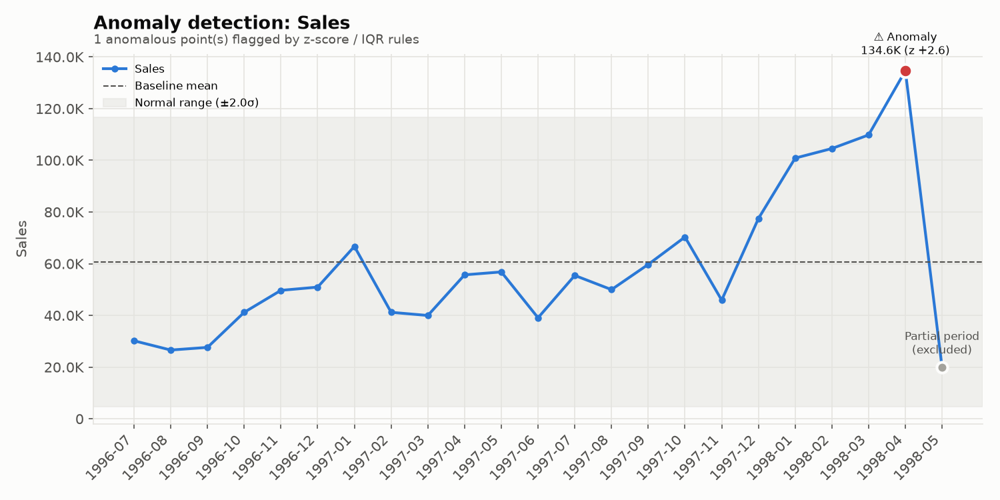

# Monthly Sales Anomaly Analysis

**Question:** Are there any unusual spikes or drops in monthly sales?  
**Analysis type:** anomaly  
**Generated:** 2026-11-18 23:45 · **LLM:** Gemini (gemini-3.5-flash-lite) · **Dataset:** Northwind

## Business Summary

Yes, an unusual sales spike occurred in April 1998, reaching a high of $134,630.56, which deviates significantly from the baseline mean of $60,661.81. While May 1998 displays a low sales figure, this is due to it being a partial period containing data only through May 6, rather than an actual business decline. Overall, sales experienced exceptional growth during early 1998 leading up to the April peak.

## Key Findings

- Peak monthly sales anomaly in April 1998 reached $134,630.56.
- The baseline monthly sales mean across the dataset is $60,661.81.
- April 1998 recorded a z-score deviation of 2.64.
- April 1998 sales deviated by 121.94% above the baseline mean.

## Visualizations

### Anomaly detection: Sales



_Values outside the normal range are highlighted._

## Root Cause Analysis

- Unusually high transaction volume or large individual orders occurred in April 1998, driving the exceptional growth in early 1998.
- May 1998 data is restricted to the period between 1996-07-04 and 1998-05-06, making it a partial period that was excluded from baseline calculations.

## Recommendations

| Priority | Action | Rationale |
|---|---|---|
| High | Investigate the specific customers, orders, and promotional activities that drove the April 1998 sales peak of $134,630.56. | Understanding the drivers behind the April 1998 anomaly helps replicate successful sales strategies. |
| Medium | Ensure future month-over-month sales performance tracking properly accounts for partial periods like May 1998 to avoid misinterpreting incomplete data as a decline. | May 1998 contains data only up to May 6, which falsely appears as a drop. |

## Data Caveats

- 1998-05 is a partial period (incomplete data, not a real decline) and was excluded from the baseline calculations.

## Suggested Next Questions

- Which specific products or customer accounts contributed the most to the April 1998 sales spike?
- What marketing campaigns or sales initiatives were active in early 1998 that resulted in consecutive months of high sales?

---
## Appendix: How This Answer Was Produced

### 1. Intent (Intent Agent)
```json
{
  "business_question": "Are there any unusual spikes or drops in monthly sales?",
  "metric": "Sales",
  "kpis": [
    "Sales",
    "Orders"
  ],
  "dimensions": [
    "Month"
  ],
  "filters": [],
  "time_period": "All",
  "time_granularity": "month",
  "analysis_type": "anomaly",
  "required_tables": [
    "orders",
    "order_details"
  ]
}
```

### 2. Execution Plan (Planning Agent)
**Objective:** Identify any unusual spikes or drops in monthly sales across the entire dataset timeline

1. Calculate monthly sales and order count across the entire dataset timeline
2. Establish baseline monthly sales performance and volatility
3. Detect outliers or values significantly deviating from the baseline
4. Highlight anomalous months and summarize findings

### 3. Data Retrieval (SQL Agent)

**primary** - Monthly Sales and Orders for anomaly detection (23 rows, 1 attempt(s))

```sql
SELECT 
  strftime('%Y-%m', o.OrderDate) AS Month,
  ROUND(SUM(od.UnitPrice * od.Quantity * (1 - od.Discount)), 2) AS Sales,
  COUNT(DISTINCT o.OrderID) AS Orders
FROM orders o
JOIN order_details od ON o.OrderID = od.OrderID
GROUP BY strftime('%Y-%m', o.OrderDate)
ORDER BY Month ASC
```

| Month   |     Sales |   Orders |
|:--------|----------:|---------:|
| 1996-07 | 30,192.10 |       22 |
| 1996-08 | 26,609.40 |       25 |
| 1996-09 | 27,636.00 |       23 |
| 1996-10 | 41,203.60 |       26 |
| 1996-11 | 49,704.00 |       25 |
| 1996-12 | 50,953.40 |       31 |
| 1997-01 | 66,692.80 |       33 |
| 1997-02 | 41,207.20 |       29 |
| 1997-03 | 39,979.90 |       30 |
| 1997-04 | 55,699.39 |       31 |

### 4. Agent Trace

| # | Agent | Step | Status | Time (s) |
|---|---|---|---|---|
| 1 | Intent Agent | understand question | ok | 7.22 |
| 2 | Planning Agent | create execution plan | ok | 1.2 |
| 3 | SQL Agent | generate SQL | ok | 2.28 |
| 4 | SQL Agent | validate SQL | ok | 0.01 |
| 5 | SQL Agent | execute SQL | ok | 0.01 |
| 6 | Analysis Agent | profile data & choose analysis | ok | 0.0 |
| 7 | Analysis Agent | anomaly detection | ok | 7.58 |
