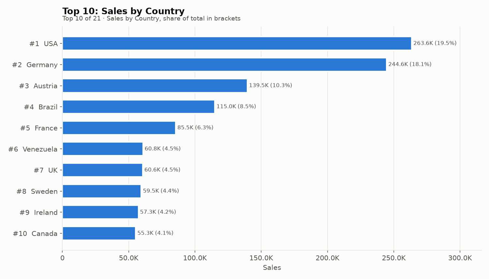

# Revenue Distribution and Top Performing Countries

**Question:** Which countries generate the most revenue?  
**Analysis type (chosen by Analysis Agent):** rank  
**Generated:** 2026-11-23 00:21 · **LLM:** Gemini (gemini-3.5-flash-lite) · **Dataset:** Northwind

## Business Summary

USA generates the most revenue with $263,566.98, representing 19.46% of total company sales across all 21 markets. Germany follows closely as the second-highest revenue generator with $244,640.63, while Austria ranks third with $139,496.63. Overall, total revenue across all countries reaches $1,354,458.59, with the top 10 markets accounting for 84.30% of this total.

## Key Findings

- USA leads all countries with $263,566.98 in sales, securing a 19.46% market share.
- Germany ranks second with $244,640.63 in sales, trailing the USA by a margin of $18,926.35.
- Austria occupies the third rank with $139,496.63 in sales, representing 10.30% of total revenue.
- The top 10 countries collectively generate $1,141,877.85, accounting for 84.30% of total company revenue.
- Total company revenue across all 21 markets stands at $1,354,458.59.

## Visualizations

### Top 10: Sales by Country



_Leaderboard with rank positions._

## Root Cause Analysis

- Revenue concentration is heavily skewed toward top-tier markets, with the top two countries (USA and Germany) driving over 37% of total sales.
- Data covers the full dataset period from 1996-07-04 to 1998-05-06 without a finer time breakdown, reflecting cumulative performance across the 21 markets.

## Recommendations

| Priority | Action | Rationale |
|---|---|---|
| High | Increase marketing and account management investments in the USA and Germany | These two markets dominate company sales, generating a combined 37.52% share of the $1,354,458.59 total revenue. |
| Medium | Evaluate expansion strategies in Austria to capitalize on its position as the third-largest market ($139,496.63 in sales) | Austria represents a strong regional hub accounting for 10.30% of total revenue. |
| Low | Review lower-performing markets such as Argentina, Norway, and Poland | These countries fall at the bottom of the 21 markets, indicating potential localized barriers to growth. |

## Data Caveats

- Totals cover the full dataset period (1996-07-04 to 1998-05-06); no time breakdown in this data.

## Suggested Next Questions

- Which specific product categories or product lines drive the highest sales within the USA and Germany?
- Who are the top-performing customers contributing to the revenue in Austria and Brazil?
- What logistics or operational factors limit sales in the lower-performing markets?

---
## Appendix: How This Answer Was Produced

### 1. Intent (Intent Agent)
```json
{
  "business_question": "Which countries generate the most revenue?",
  "metric": "Sales",
  "kpis": [
    "Sales"
  ],
  "dimensions": [
    "Country"
  ],
  "filters": [],
  "time_period": "All",
  "time_granularity": "none",
  "required_tables": [
    "customers",
    "orders",
    "order_details"
  ]
}
```

### 2. Execution Plan (Planning Agent)
**Objective:** Identify the countries that generate the most revenue in Northwind orders.

1. Retrieve total sales revenue grouped by customer country
2. Calculate total sales and sort by country descending
3. Identify the top revenue-generating countries

### 3. Data Retrieval (SQL Agent)

**primary** - Total sales revenue and order count by customer country across all years (21 rows, 1 attempt(s))

```sql
SELECT 
  c.Country AS Country,
  ROUND(SUM(od.UnitPrice * od.Quantity * (1 - od.Discount)), 2) AS Sales,
  COUNT(DISTINCT o.OrderID) AS OrderCount
FROM customers c
JOIN orders o ON c.CustomerID = o.CustomerID
JOIN order_details od ON o.OrderID = od.OrderID
GROUP BY c.Country
ORDER BY Sales DESC
```

| Country   |      Sales |   OrderCount |
|:----------|-----------:|-------------:|
| USA       | 263,566.98 |          122 |
| Germany   | 244,640.63 |          122 |
| Austria   | 139,496.63 |           40 |
| Brazil    | 114,968.48 |           83 |
| France    |  85,498.76 |           77 |
| Venezuela |  60,814.89 |           46 |
| UK        |  60,616.51 |           56 |
| Sweden    |  59,523.70 |           37 |
| Ireland   |  57,317.39 |           19 |
| Canada    |  55,334.10 |           30 |

### 5. Native Tool Calls

| # | Agent | Tool | Arguments |
|---|---|---|---|
| 1 | Intent Agent | `submit_intent` | {"required_tables": ["customers", "orders", "order_details"], "business_question": "Which countries generate the most re |
| 2 | Planning Agent | `submit_plan` | {"required_kpis": ["Sales", "OrderCount"], "analysis_steps": ["Retrieve total sales revenue grouped by customer country" |
| 3 | SQL Agent | `submit_sql_query` | {"tables_used": ["customers", "orders", "order_details"], "sql": "SELECT \n  c.Country AS Country,\n  ROUND(SUM(od.UnitP |
| 4 | Analysis Agent | `rank_analysis` | {"dataset_id": "primary", "top_n": 10} |
| 5 | Analysis Agent | `submit_analysis` | {"key_findings": [{"finding": "Top Country (USA) Sales", "value": "$263,566.98 (19.46% share)"}, {"value": "$244,640.63  |

### 6. Agent Trace

| # | Agent | Step | Status | Time (s) |
|---|---|---|---|---|
| 1 | Intent Agent | understand question + guardrails | ok | 2.11 |
| 2 | Planning Agent | create execution plan | ok | 2.05 |
| 3 | SQL Agent | generate SQL | ok | 1.74 |
| 4 | SQL Agent | validate SQL | ok | 0.01 |
| 5 | SQL Agent | execute SQL | ok | 0.01 |
| 6 | Analysis Agent | choose analysis via tool calling | ok | 13.43 |
