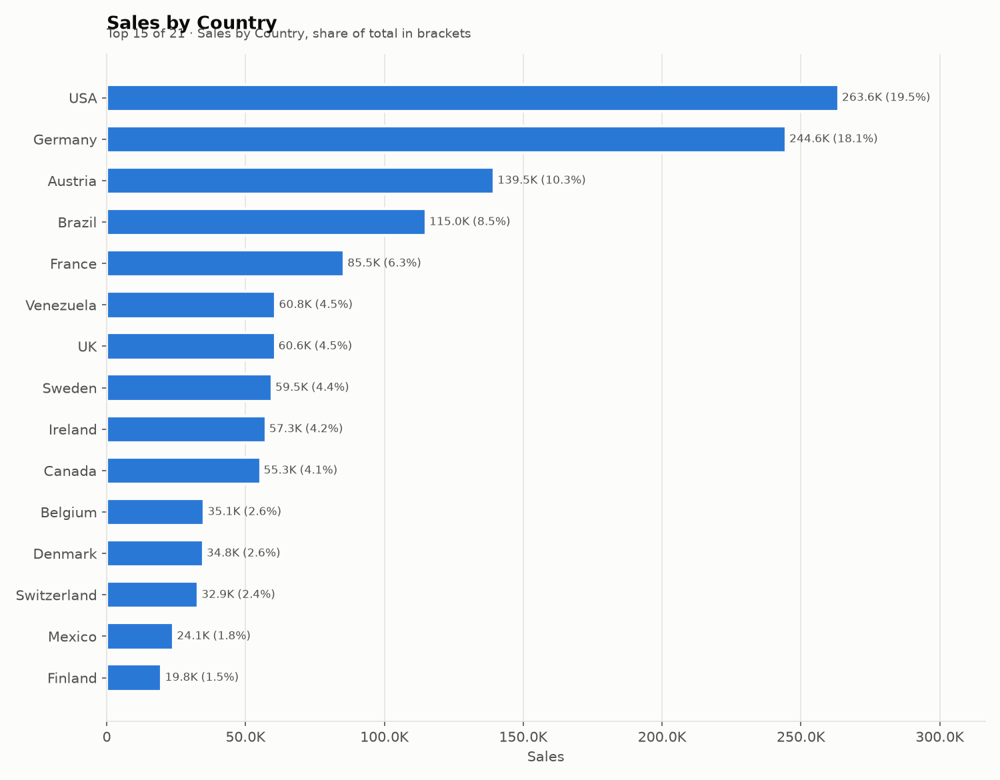

# Geographical Revenue Concentration Report

**Question:** Which countries generate the most revenue?  
**Analysis type:** comparison  
**Generated:** 2026-11-18 23:46 · **LLM:** Gemini (gemini-3.5-flash-lite) · **Dataset:** Northwind

## Business Summary

USA and Germany generate the highest revenue, with total sales of $263,566.98 and $244,640.63 respectively, driving a significant portion of the total $1,354,458.59. The top 9 countries contribute 80% of total revenue, highlighting a strong geographical concentration across the 21 active markets. Note that the underlying dataset covers the period from 1996-07-04 to 1998-05-06, meaning 1996 and 1998 represent partial years.

## Key Findings

- Top revenue-generating country is USA with $263,566.98, representing a 19.46% share of total sales.
- Second highest revenue country is Germany with $244,640.63, representing an 18.06% share.
- Austria contributes $139,496.63 (10.30% share) and Brazil contributes $114,968.48 (8.49% share) to round out the top tier.
- Lowest revenue country in the dataset is Poland, generating $3,531.95 or 0.26% of total sales.
- A total of 9 countries are required to reach 80% of total sales, reflecting high market concentration.

## Visualizations

### Sales by Country



_Ranking of members by the metric._

## Root Cause Analysis

- Strong customer base and robust market penetration established in core regions like the USA ($263,566.98).
- Strong demand in key European core markets, particularly Germany ($244,640.63) and Austria ($139,496.63).
- Dataset contains orders from 1996-07-04 to 1998-05-06 only, making 1996 and 1998 partial years that require caution when performing year-over-year comparisons.

## Recommendations

| Priority | Action | Rationale |
|---|---|---|
| High | Prioritize marketing and expansion strategies to nurture high-value core markets in the USA ($263,566.98) and Germany ($244,640.63). | These two top markets together represent over 37% of total sales. |
| High | Allocate sales and resource efforts to support top-performing regions such as Austria ($139,496.63) and Brazil ($114,968.48) to maximize return on investment. | The top 9 countries contribute 80% of total revenue. |
| Medium | Evaluate the underlying drivers for underperforming regions like Poland ($3,531.95) and Norway ($5,735.15) to decide whether to scale up local campaigns or reallocate budget. | Low-share countries represent untapped potential or unprofitable distribution channels. |

## Data Caveats

- Dataset contains orders from 1996-07-04 to 1998-05-06 only. 1996 contains only Jul-Dec and 1998 only Jan-early May. Year-over-year totals for 1996 and 1998 are PARTIAL years; compare equal periods (e.g. Jan-Apr) or monthly averages.

## Suggested Next Questions

- Which specific product categories drive the highest sales in the USA and Germany?
- How do customer acquisition costs vary between our top 5 countries and underperforming markets like Poland and Norway?
- What do monthly average sales look like when controlling for the partial-period dates between 1996 and 1998?

---
## Appendix: How This Answer Was Produced

### 1. Intent (Intent Agent)
```json
{
  "business_question": "Which countries generate the most revenue?",
  "metric": "Sales",
  "kpis": [
    "Sales"
  ],
  "dimensions": [
    "Country"
  ],
  "filters": [],
  "time_period": "All",
  "time_granularity": "none",
  "analysis_type": "comparison",
  "required_tables": [
    "customers",
    "orders",
    "order_details"
  ]
}
```

### 2. Execution Plan (Planning Agent)
**Objective:** Determine which customer countries generate the highest total revenue across all available data

1. Aggregate total sales by customer country
2. Rank countries in descending order of sales
3. Compute the revenue share for top countries

### 3. Data Retrieval (SQL Agent)

**primary** - Total sales aggregated by customer country (21 rows, 1 attempt(s))

```sql
SELECT c.Country AS Country, ROUND(SUM(od.UnitPrice * od.Quantity * (1 - od.Discount)), 2) AS Sales FROM customers c JOIN orders o ON c.CustomerID = o.CustomerID JOIN order_details od ON o.OrderID = od.OrderID GROUP BY c.Country ORDER BY Sales DESC
```

| Country   |      Sales |
|:----------|-----------:|
| USA       | 263,566.98 |
| Germany   | 244,640.63 |
| Austria   | 139,496.63 |
| Brazil    | 114,968.48 |
| France    |  85,498.76 |
| Venezuela |  60,814.89 |
| UK        |  60,616.51 |
| Sweden    |  59,523.70 |
| Ireland   |  57,317.39 |
| Canada    |  55,334.10 |

### 4. Agent Trace

| # | Agent | Step | Status | Time (s) |
|---|---|---|---|---|
| 1 | Intent Agent | understand question | ok | 6.95 |
| 2 | Planning Agent | create execution plan | ok | 3.98 |
| 3 | SQL Agent | generate SQL | ok | 8.95 |
| 4 | SQL Agent | validate SQL | ok | 0.01 |
| 5 | SQL Agent | execute SQL | ok | 0.01 |
| 6 | Analysis Agent | profile data & choose analysis | ok | 0.0 |
| 7 | Analysis Agent | comparison analysis | ok | 11.56 |
