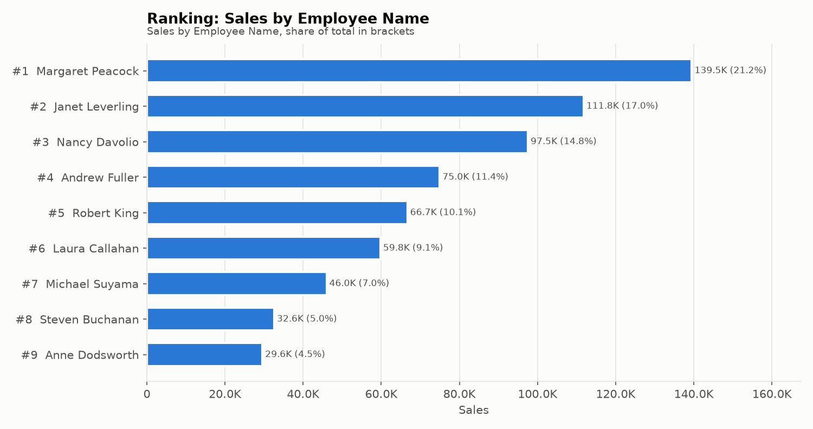

# Employee Sales Performance Report for 1997

**Question:** Which employees generated the highest sales in 1997?  
**Analysis type (chosen by Analysis Agent):** rank  
**Generated:** 2026-11-23 00:26 · **LLM:** Gemini (gemini-3.5-flash-lite) · **Dataset:** Northwind

## Business Summary

In 1997, Margaret Peacock generated the highest sales with $139,477.70 across 81 orders, leading all 9 ranked employees. Janet Leverling secured second place with $111,788.61 from 71 orders, followed by Nancy Davolio in third place with $97,533.58 from 55 orders. Together, these top three employees contributed over half of the total ranked sales of $658,388.75.

## Key Findings

- Margaret Peacock led 1997 sales with $139,477.70 (81 orders), outperforming the second-place employee by $27,689.09 or 24.77%.
- Janet Leverling ranked second with $111,788.61 across 71 orders, representing a 16.98% share of the total ranked sales.
- Nancy Davolio achieved third place with $97,533.58 across 55 orders, accounting for a 14.81% share.
- Andrew Fuller and Robert King generated $74,958.60 (11.39% share) and $66,689.14 (10.13% share) respectively.
- The lowest-ranked employees in 1997 were Steven Buchanan with $32,595.05 (4.95% share) and Anne Dodsworth with $29,577.55 (4.49% share).

## Visualizations

### Ranking: Sales by Employee Name



_Leaderboard with rank positions._

## Root Cause Analysis

- Performance disparities among employees show that the top three sales representatives (Margaret Peacock, Janet Leverling, and Nancy Davolio) account for 52.98% of total ranked sales.
- Order volume heavily correlates with total revenue generation, as seen with Margaret Peacock leading both total sales and order count (81 orders).
- Dataset parameters cover the full dataset period from 1996-07-04 to 1998-05-06, pre-filtered for 1997 transactions.

## Recommendations

| Priority | Action | Rationale |
|---|---|---|
| High | Analyze Margaret Peacock's sales strategies, customer accounts, and product mix to establish best practices for the broader team. | Margaret Peacock is the top sales generator by a significant margin ($139,477.70), contributing over a fifth of the total 1997 sales. |
| Medium | Provide targeted sales training and account support for lower-performing representatives such as Steven Buchanan and Anne Dodsworth. | Steven Buchanan and Anne Dodsworth generated the lowest sales in 1997 at $32,595.05 and $29,577.55 respectively, indicating a large performance gap. |
| Medium | Evaluate the order conversion rates and average order values for mid-tier representatives like Andrew Fuller ($74,958.60) and Robert King ($66,689.14). | Understanding mid-tier performance can help bridge the gap toward top-tier revenue generation. |

## Data Caveats

- Data covers full dataset period 1996-07-04 to 1998-05-06, pre-filtered for 1997 sales.

## Suggested Next Questions

- Which specific product categories or high-value customers drove Margaret Peacock's leading sales in 1997?
- How does the order size and discount frequency compare between top-performing employees and lower-ranked employees?

---
## Appendix: How This Answer Was Produced

### 1. Intent (Intent Agent)
```json
{
  "business_question": "Which employees generated the highest sales in 1997?",
  "metric": "Sales",
  "kpis": [
    "Sales",
    "Orders"
  ],
  "dimensions": [
    "Employee"
  ],
  "filters": [],
  "time_period": "1997",
  "time_granularity": "none",
  "required_tables": [
    "employees",
    "orders",
    "order_details"
  ]
}
```

### 2. Execution Plan (Planning Agent)
**Objective:** Identify the employees who generated the highest sales in 1997

1. Filter orders for the year 1997
2. Join employees, orders, and order_details to calculate total sales and order count per employee
3. Sort employees by sales in descending order
4. Identify top performing employees for 1997

### 3. Data Retrieval (SQL Agent)

**primary** - Retrieve total sales and order count per employee for the year 1997 (9 rows, 1 attempt(s))

```sql
SELECT 
    e.FirstName || ' ' || e.LastName AS EmployeeName,
    ROUND(SUM(od.UnitPrice * od.Quantity * (1 - od.Discount)), 2) AS Sales,
    COUNT(DISTINCT o.OrderID) AS Orders
FROM employees e
JOIN orders o ON e.EmployeeID = o.EmployeeID
JOIN order_details od ON o.OrderID = od.OrderID
WHERE strftime('%Y', o.OrderDate) = '1997'
GROUP BY e.EmployeeID
ORDER BY Sales DESC
```

| EmployeeName     |      Sales |   Orders |
|:-----------------|-----------:|---------:|
| Margaret Peacock | 139,477.70 |       81 |
| Janet Leverling  | 111,788.61 |       71 |
| Nancy Davolio    |  97,533.58 |       55 |
| Andrew Fuller    |  74,958.60 |       41 |
| Robert King      |  66,689.14 |       36 |
| Laura Callahan   |  59,776.52 |       54 |
| Michael Suyama   |  45,992.00 |       33 |
| Steven Buchanan  |  32,595.05 |       18 |
| Anne Dodsworth   |  29,577.55 |       19 |

### 5. Native Tool Calls

| # | Agent | Tool | Arguments |
|---|---|---|---|
| 1 | Intent Agent | `submit_intent` | {"time_period": "1997", "required_tables": ["employees", "orders", "order_details"], "metric": "Sales", "filters": [], " |
| 2 | Planning Agent | `submit_plan` | {"data_queries": [{"description": "columns: EmployeeName (concatenation of FirstName and LastName), Sales, Orders. Filte |
| 3 | SQL Agent | `submit_sql_query` | {"sql": "SELECT \n    e.FirstName \|\| ' ' \|\| e.LastName AS EmployeeName,\n    ROUND(SUM(od.UnitPrice * od.Quantity *  |
| 4 | Analysis Agent | `rank_analysis` | {"top_n": 9, "ascending": false, "dataset_id": "primary"} |
| 5 | Analysis Agent | `submit_analysis` | {"summary": "In 1997, Margaret Peacock generated the highest sales with $139,477.70 (81 orders), followed by Janet Lever |

### 6. Agent Trace

| # | Agent | Step | Status | Time (s) |
|---|---|---|---|---|
| 1 | Intent Agent | understand question + guardrails | ok | 1.91 |
| 2 | Planning Agent | create execution plan | ok | 1.92 |
| 3 | SQL Agent | generate SQL | ok | 2.43 |
| 4 | SQL Agent | validate SQL | ok | 0.02 |
| 5 | SQL Agent | execute SQL | ok | 0.03 |
| 6 | Analysis Agent | choose analysis via tool calling | ok | 18.41 |
