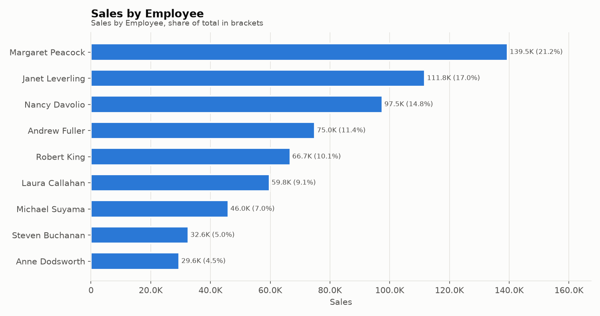

# Employee Sales Performance Report for 1997

**Question:** Which employees generated the highest sales in 1997?  
**Analysis type:** comparison  
**Generated:** 2026-11-18 23:48 · **LLM:** Gemini (gemini-3.5-flash-lite) · **Dataset:** Northwind

## Business Summary

In 1997, total sales reached 658,388.75 across 9 employees, with Margaret Peacock generating the highest sales at 139,477.70. Sales performance is heavily skewed toward top representatives, with the top two employees accounting for over 38% of total revenue and the top three accounting for over half. Meanwhile, Anne Dodsworth recorded the lowest sales at 29,577.55.

## Key Findings

- Margaret Peacock led all employees with 139,477.70 in sales, representing a 21.18% share of the total.
- Janet Leverling ranked second with 111,788.61 in sales (16.98% share), and Nancy Davolio ranked third with 97,533.58 (14.81% share).
- Anne Dodsworth recorded the lowest sales among the 9 employees at 29,577.55 (4.49% share).
- Total annual sales across all employees in 1997 amounted to 658,388.75.
- The top 20% of members account for 38.16% of total revenue, highlighting a heavy reliance on top performers.

## Visualizations

### Sales by Employee



_Ranking of members by the metric._

## Root Cause Analysis

- Sales performance is heavily skewed toward top representatives, creating key-person risk and a wide disparity where top performers outpace bottom performers by a ratio of 4.72.
- The dataset contains orders from 1996-07-04 to 1998-05-06 only, making 1996 and 1998 partial years, which establishes 1997 as the primary complete annual period for full evaluation.

## Recommendations

| Priority | Action | Rationale |
|---|---|---|
| High | Implement peer mentoring programs pairing top sales representatives like Margaret Peacock and Janet Leverling with lower-performing staff such as Anne Dodsworth and Steven Buchanan. | Sales performance is heavily skewed with Margaret Peacock generating 139,477.70 compared to Anne Dodsworth's 29,577.55, indicating an opportunity to replicate best practices. |
| Medium | Review account allocations and territory assignments to ensure lower-performing representatives like Anne Dodsworth and Steven Buchanan have adequate opportunities. | The bottom representatives account for significantly smaller shares of the 658,388.75 total sales. |
| Medium | Establish targeted training initiatives focused on product positioning and client management for representatives falling below the mean sales threshold of 73,154.31. | Six members are required to reach 80% of total sales, showing that the lower half of employees underperform relative to the mean. |

## Data Caveats

- Dataset contains orders from 1996-07-04 to 1998-05-06 only. 1996 contains only Jul-Dec and 1998 only Jan-early May. Year-over-year totals for 1996 and 1998 are PARTIAL years; compare equal periods (e.g. Jan-Apr) or monthly averages.

## Suggested Next Questions

- What specific product categories or customer accounts drove Margaret Peacock's 139,477.70 in sales during 1997?
- How do individual employee sales trends in 1997 compare during the partial periods available in 1996 and 1998?

---
## Appendix: How This Answer Was Produced

### 1. Intent (Intent Agent)
```json
{
  "business_question": "Which employees generated the highest sales in 1997?",
  "metric": "Sales",
  "kpis": [
    "Sales"
  ],
  "dimensions": [
    "Employee"
  ],
  "filters": [],
  "time_period": "1997",
  "time_granularity": "none",
  "analysis_type": "comparison",
  "required_tables": [
    "employees",
    "orders",
    "order_details"
  ]
}
```

### 2. Execution Plan (Planning Agent)
**Objective:** Identify the employees who generated the highest total sales in 1997

1. Aggregate sales by employee for the year 1997
2. Rank employees in descending order of sales
3. Compute the contribution share of each employee to total 1997 sales

### 3. Data Retrieval (SQL Agent)

**primary** - Total sales by employee in 1997 (9 rows, 1 attempt(s))

```sql
SELECT 
    e.FirstName || ' ' || e.LastName AS Employee,
    ROUND(SUM(od.UnitPrice * od.Quantity * (1 - od.Discount)), 2) AS Sales,
    COUNT(DISTINCT o.OrderID) AS OrderCount
FROM employees e
JOIN orders o ON e.EmployeeID = o.EmployeeID
JOIN order_details od ON o.OrderID = od.OrderID
WHERE strftime('%Y', o.OrderDate) = '1997'
GROUP BY e.EmployeeID, e.FirstName, e.LastName
ORDER BY Sales DESC
```

| Employee         |      Sales |   OrderCount |
|:-----------------|-----------:|-------------:|
| Margaret Peacock | 139,477.70 |           81 |
| Janet Leverling  | 111,788.61 |           71 |
| Nancy Davolio    |  97,533.58 |           55 |
| Andrew Fuller    |  74,958.60 |           41 |
| Robert King      |  66,689.14 |           36 |
| Laura Callahan   |  59,776.52 |           54 |
| Michael Suyama   |  45,992.00 |           33 |
| Steven Buchanan  |  32,595.05 |           18 |
| Anne Dodsworth   |  29,577.55 |           19 |

### 4. Agent Trace

| # | Agent | Step | Status | Time (s) |
|---|---|---|---|---|
| 1 | Intent Agent | understand question | ok | 7.96 |
| 2 | Planning Agent | create execution plan | ok | 6.9 |
| 3 | SQL Agent | generate SQL | ok | 9.18 |
| 4 | SQL Agent | validate SQL | ok | 0.02 |
| 5 | SQL Agent | execute SQL | ok | 0.03 |
| 6 | Analysis Agent | profile data & choose analysis | ok | 0.01 |
| 7 | Analysis Agent | comparison analysis | ok | 17.53 |
