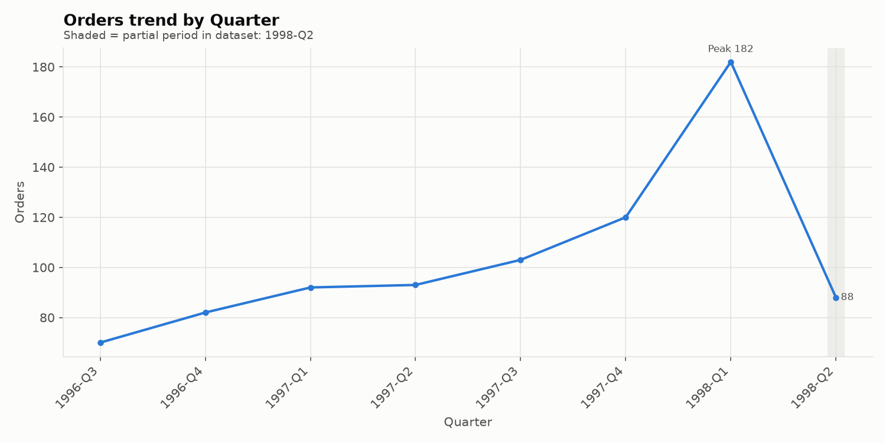

# Quarterly Order Volume Trend Analysis

**Question:** How has the number of orders changed per quarter?  
**Analysis type:** trend  
**Generated:** 2026-11-19 00:19 · **LLM:** Gemini (gemini-3.5-flash-lite) · **Dataset:** Northwind

## Business Summary

The number of orders showed an overall upward trend from 1996-Q3 through 1998-Q1, growing by 160.0% between complete periods. Order counts expanded consistently from 70 orders in 1996-Q3 to a peak of 182 orders in 1998-Q1. An apparent drop to 88 orders in 1998-Q2 is due to incomplete data coverage rather than a real business decline.

## Key Findings

- Lowest order count in the dataset was 70 orders in 1996-Q3.
- Peak order count achieved was 182 orders in 1998-Q1.
- Biggest period-over-period increase was 51.67% growth in 1998-Q1.
- Overall change between complete periods (1996-Q3 to 1998-Q1) was +160.0%.

## Visualizations

### Orders trend by Quarter



_Metric over time (one line per member when a dimension is present)._

## Root Cause Analysis

- Consistent quarterly volume expansion up to 1998-Q1 indicates strong customer acquisition and growing demand.
- Strongest sequential growth surge of 51.67% occurred in 1998-Q1.
- Dataset contains orders from 1996-07-04 to 1998-05-06 only.
- 1998-Q2 is a partial period containing data only up to May 6, 1998; the apparent decline to 88 orders is not a real decline.

## Recommendations

| Priority | Action | Rationale |
|---|---|---|
| High | Investigate the operational drivers behind the 51.67% growth surge in 1998-Q1 to replicate successful customer acquisition strategies. | Linked to the finding that 1998-Q1 achieved a peak of 182 orders and the biggest period-over-period increase. |
| Medium | Establish full-quarter data collection protocols for future reporting periods to prevent partial-period distortions like the 1998-Q2 drop. | Linked to the caveat that 1998-Q2 only contains data up to May 6, 1998. |
| High | Analyze customer purchasing patterns established between 1996-Q3 (70 orders) and 1998-Q1 (182 orders) to maintain the upward trend direction. | Linked to the 160.0% overall growth between complete periods. |

## Data Caveats

- Dataset contains orders from 1996-07-04 to 1998-05-06 only.
- 1998-Q2 is a partial period containing data only up to May 6, 1998; the apparent decline to 88 orders is not a real decline.

## Suggested Next Questions

- What specific marketing or sales initiatives drove the 51.67% order volume increase in 1998-Q1?
- How does the complete monthly run-rate for 1998-Q2 compare to 1998-Q1 once normalized for partial data?
- Which customer segments or geographic regions contributed most to the growth from 70 orders in 1996-Q3 to 182 orders in 1998-Q1?

---
## Appendix: How This Answer Was Produced

### 1. Intent (Intent Agent)
```json
{
  "business_question": "How has the number of orders changed per quarter?",
  "metric": "Orders",
  "kpis": [
    "Orders"
  ],
  "dimensions": [
    "Quarter"
  ],
  "filters": [],
  "time_period": "All",
  "time_granularity": "quarter",
  "analysis_type": "trend",
  "required_tables": [
    "orders"
  ]
}
```

### 2. Execution Plan (Planning Agent)
**Objective:** Analyze the trend in the number of orders placed per quarter from 1996 to 1998

1. Calculate the number of orders per quarter
2. Compare order counts across quarters to identify growth or decline trends
3. Flag partial periods for 1996 and 1998

### 3. Data Retrieval (SQL Agent)

**primary** - Calculate total number of orders grouped by quarter (8 rows, 1 attempt(s))

```sql
SELECT 
    strftime('%Y', o.OrderDate) || '-Q' || ((CAST(strftime('%m', o.OrderDate) AS INTEGER) + 2) / 3) AS Quarter,
    COUNT(DISTINCT o.OrderID) AS Orders
FROM orders o
GROUP BY Quarter
ORDER BY Quarter
```

| Quarter   |   Orders |
|:----------|---------:|
| 1996-Q3   |       70 |
| 1996-Q4   |       82 |
| 1997-Q1   |       92 |
| 1997-Q2   |       93 |
| 1997-Q3   |      103 |
| 1997-Q4   |      120 |
| 1998-Q1   |      182 |
| 1998-Q2   |       88 |

### 4. Agent Trace

| # | Agent | Step | Status | Time (s) |
|---|---|---|---|---|
| 1 | Intent Agent | understand question | ok | 2.2 |
| 2 | Planning Agent | create execution plan | ok | 1.66 |
| 3 | SQL Agent | generate SQL | ok | 2.01 |
| 4 | SQL Agent | validate SQL | ok | 0.01 |
| 5 | SQL Agent | execute SQL | ok | 0.01 |
| 6 | Analysis Agent | profile data & choose analysis | ok | 0.0 |
| 7 | Analysis Agent | trend analysis | ok | 2.03 |
